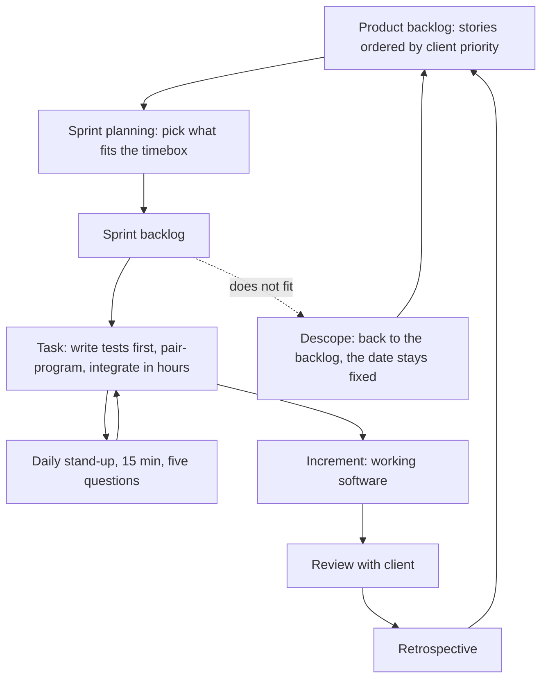

<div dir="rtl">

# یادداشت ۰۶ — روش‌های agile: XP، Scrum، Kanban، timeboxing و stand-up

> ماژول ۰۱ · مهندسی نرم‌افزار پیشرفته · ترم ۱ · نسخهٔ انگلیسی: [`06-agile-methods.en.md`](06-agile-methods.en.md) · فهرست: [`INDEX.fa.md`](INDEX.fa.md)

## ۱. خلاصه

- فرایندهای agile نرم‌افزار کارا، همکاری با مشتری و پاسخ به تغییر را بر تحلیل و طراحی مفصل پیشاپیش مقدم می‌دارند. بر مدل iterative-and-incremental سوارند و **زمان ثابت، نه قابلیت ثابت** را مبنا می‌گیرند (`Schach 8e, ch. 2 §2.9.5`).
- Schach روش Extreme Programming (stories، test-driven development، pair programming، refactoring) و دو تکنیک مدیریتی را که از XP بیشتر عمر کردند معرفی می‌کند: **timeboxing** و **stand-up** روزانه با پنج پرسش. Scrum و Kanban چارچوب‌های امروزی‌اند که Schach فقط گذرا از آن‌ها نام می‌برد.
- Schach (۲۰۱۰): agile برای محصول‌های کوچک‌مقیاس با نیازمندی مبهم کار می‌کند؛ برای پروژه‌های متوسط و بزرگ شواهدی وجود نداشت. این گزارهٔ تاریخ‌دار است (کادر بخش ۵).

## ۲. توضیح

### شهود

وقتی مشتری تا چیزی نبیند نمی‌تواند بگوید چه می‌خواهد، یک specification بلند حدس است. agile حلقهٔ بازخورد را کوتاه می‌کند: یک تکهٔ کوچک بساز، نشان بده، اصلاح کن. بهایش این است که از پیش‌بینی دامنهٔ نهایی در روز اول چشم می‌پوشید.

### Agile Manifesto

Manifesto (agilemanifesto.org، حق نشر ۲۰۰۱، برای این یادداشت باز شد) چهار ارزش را به‌شکل ترجیح بیان می‌کند: «Individuals and interactions over processes and tools»، «Working software over comprehensive documentation»، «Customer collaboration over contract negotiation»، «Responding to change over following a plan»، و بعد: با اینکه مورد سمت راست هم ارزش دارد، مورد سمت چپ را بیشتر ارزش می‌نهیم. Schach (ch. 2 §2.9.5) ثبت می‌کند که هفده توسعه‌دهنده آن را در فوریهٔ ۲۰۰۱ نوشتند و Manifesto اصول را نام می‌برد، نه یک life-cycle model را. بسیاری از آن‌ها روش خودشان را داشتند (XP، Crystal، Scrum).

### XP آن‌گونه که Schach ارائه می‌کند (ch. 2 §2.9.5، ch. 4 §4.6)

1. **Stories.** تیم قابلیت‌های مورد نظر مشتری را فهرست می‌کند و برای هر کدام مدت و هزینه می‌دهد. مشتری با cost-benefit analysis قابلیت‌های هر build را برمی‌گزیند.
2. **Task و TDD.** build به taskها تقسیم می‌شود. test caseها *پیش از* کد نوشته می‌شوند (test-driven development) و برای همهٔ integration testing بعدی نگه داشته می‌شوند.
3. **Pair programming.** دو برنامه‌نویس یک رایانه را شریک‌اند و هر ۱۵ تا ۲۰ دقیقه تایپ را عوض می‌کنند. دلایل Schach (§4.6): کسی فقط کد خودش را test نمی‌کند، دانش با رفتن یک نفر از بین نمی‌رود، تازه‌کارها یاد می‌گیرند و کد مالکیت گروهی پیدا می‌کند.
4. **Continuous integration** taskهای کوچک: پیاده‌سازی و integrate یک task باید چند ساعت طول بکشد.
5. **Refactoring به‌جای گام طراحی پیشاپیش**: وقتی test اجرا نمی‌شود، کد بازآرایی می‌شود تا طراحی ساده شود. مخفف‌های YAGNI و DTSTTCPW یعنی «فقط آنچه لازم است را بساز».
6. ویژگی‌های دیگر: نمایندهٔ مشتری در محل، دو هفتهٔ پیاپی اضافه‌کاری ممنوع، تخصص‌گرایی نیست.

شواهد دربارهٔ pair programming متناقض است (§2.9.5، §4.6): یک مطالعه کد بهتر در زمان کمتر دید؛ آزمایش ۲۰۰۷ با ۲۹۵ حرفه‌ای نشان داد pairها در کارهای maintenance ۸۴٪ تلاش بیشتر لازم دارند؛ تحلیل ۱۵ مطالعه نتیجه گرفت بسته به تخصص و پیچیدگی وظیفه است.

### Timeboxing

مقدار ثابتی زمان کنار گذاشته می‌شود و تیم در همان زمان بهترین کار ممکن را می‌کند. توصیف Schach: iterationهایی حدود سه هفته؛ وقتی مشتری کار را انتخاب کرد دیگر نمی‌توان آن را زیاد کرد؛ اگر جا نشد، کار **descope** می‌شود. به تعبیر Schach، agile زمان ثابت می‌خواهد نه قابلیت ثابت. این برعکس waterfall است که دامنهٔ ثابت و تاریخ متحرک دارد.

### Stand-up روزانه

جلسه‌ای کوتاه هر روز، ایستاده و در دایره تا از ۱۵ دقیقهٔ تعیین‌شده بیشتر نشود. هر عضو به پنج پرسش پاسخ می‌دهد (`Schach 8e, ch. 2 §2.9.5`): از جلسهٔ دیروز تا حالا چه کرده‌ام؛ امروز روی چه کار می‌کنم؛ چه مشکلی جلوی من را گرفته؛ چه چیزی را فراموش کرده‌ایم؛ چه آموخته‌ام که بخواهم با تیم در میان بگذارم. هدف **مطرح کردن** مشکل است، نه حل آن؛ راه‌حل در جلسهٔ پیگیری بلافاصله پس از stand-up می‌آید.

Schach timeboxing و stand-up را نمونه‌هایی از دو اصل پایه‌ای agile می‌داند: ارتباط، و برآورده کردن هرچه سریع‌تر نیاز مشتری.

### Scrum (باز شد: The Scrum Guide، نوامبر ۲۰۲۰)

نسخهٔ ۲۰۲۰ سه accountability را نام می‌برد (**Developers، Product Owner، Scrum Master**)، پنج event (**the Sprint، Sprint Planning، Daily Scrum، Sprint Review، Sprint Retrospective**)، سه artifact (**Product Backlog، Sprint Backlog، Increment**) که هر کدام یک commitment دارند (**Product Goal، Sprint Goal، Definition of Done**). Sprint یک ماه یا کمتر است و Daily Scrum ۱۵ دقیقه. VERSION-DEPENDENT: ویرایش‌های دیگر Guide نقش‌ها و eventها را متفاوت بیان می‌کنند؛ فقط متن ۲۰۲۰ بررسی شد (نام‌ها و دو timebox). اینکه Guide ۲۰۲۰ قالب ثابتی از پرسش‌ها برای Daily Scrum تجویز می‌کند یا نه بررسی نشد (`UNVERIFIED`)؛ شکل پنج‌پرسشی Schach نسخهٔ کلاسیک آموزشی است.

### Kanban (باز شد: The Kanban Guide، v2025.5، مه ۲۰۲۵)

Kanban iteration یا نقش ندارد. workflow را نمایان می‌کند، work in progress را محدود می‌کند و flow را مدیریت می‌کند. Guide چهار flow metric تعریف می‌کند: **WIP** (itemهای شروع‌شدهٔ تمام‌نشده)، **throughput** (itemهای تمام‌شده در واحد زمان)، **work item age** (زمان از شروع برای itemی که هنوز تمام نشده) و **cycle time** (از شروع تا پایان). کنترل WIP آن را به سیستم pull تبدیل می‌کند: کار تازه فقط وقتی شروع می‌شود که ظرفیت باشد. Kanban از lean manufacturing می‌آید و Schach آن را پوشش نمی‌دهد. آزمایش ۰۵ را ببینید.

### agile کجا جواب می‌دهد

| عامل | agile خوب جواب می‌دهد | agile سخت می‌شود |
|---|---|---|
| Requirements | مبهم و در حال تغییر | ثابت و کاملاً معلوم، یا قراردادی و بسته |
| اندازه | تیم کوچک، یک محصول | صدها توسعه‌دهنده، interfaceهای بسیار |
| مشتری | در محل و صاحب‌اختیار | غایب، یا فقط یک قرارداد |
| ریسک | متوسط؛ شکست ارزان است | safety-critical و نیازمند certification |
| مستندات | کد و test کافی است | نظارت‌گر یا نگه‌دارنده به مستندات طراحی نیاز دارد |

Schach (§2.9.5، به نقل از Booch): برای لانهٔ سگ نقشه لازم نیست؛ خانه نقشه و صنعتگران مختلف می‌خواهد؛ هزار لانهٔ سگ روی هم آسمان‌خراش نمی‌شود. او پرسش maintenance را هم مطرح می‌کند: refactoring دائمی است، پس اگر هر قابلیت تازه refactoring بخواهد، هزینهٔ postdelivery ممکن است بالا باشد و در ۲۰۱۰ تقریباً داده‌ای نبود.

## ۳. نمودار

</div>



<div dir="rtl">

## ۴. مثال عملی

برنامهٔ یک sprint با timebox برای پروژهٔ ثبت‌نام. فرض‌های ظرفیت (۳ pair، ۱۰ روز، ۵۰٪ focus) ساختگی ولی صریح‌اند؛ برآوردها بر حسب pair-day. اسکریپت scratch، بیرون از repo:

</div>

```text
$ python -I timebox.py
timebox = 10 working days, 3 pairs, focus factor 0.5 -> capacity 15.0 pair-days
  IN   p1 Search courses       3 d  (cumulative 3)
  IN   p2 Enroll in a course   5 d  (cumulative 8)
  IN   p3 Prerequisite check   4 d  (cumulative 12)
  OUT  p4 Waiting list         4 d  -> next timebox (descoped)
  IN   p5 Email receipt        2 d  (cumulative 14)
  OUT  p6 Admin export CSV     3 d  -> next timebox (descoped)
delivered 4 stories, descoped 2; the date did not move
fixed scope instead: 21 d of work / (3 * 0.5) = 14.0 working days
```

<div dir="rtl">

خواندن آن:

- زمان روی ۱۰ روز ثابت است و دامنه متغیر؛ دید waterfall ۲۱ روز دامنه را ثابت می‌گیرد و تاریخ را تا ۱۴ روز (و در عمل بیشتر) جابه‌جا می‌کند.
- دو story از شش تا حذف می‌شود، بر پایهٔ اولویت مشتری نه تیم. waiting list (اولویت ۴) حذف می‌شود ولی receipt ارزان‌تر اولویت ۵ جا می‌شود. قاعدهٔ «هیچ‌وقت از اولویت بالاتر رد نشو» آن را هم حذف می‌کرد؛ تیم باید تصمیم بگیرد کدام قاعده را دارد.
- ضریب focus ۵۰٪ فرض است نه اندازه‌گیری؛ تیم واقعی باید آن را از sprintهای گذشته اندازه بگیرد.

## ۵. حالت‌های خاص و دام‌ها

- **Scrum همان XP نیست.** Scrum نقش‌ها و eventها را تجویز می‌کند ولی عملکرد مهندسی نه؛ XP عملکردها (TDD، pairing، refactoring) را تجویز می‌کند ولی نقش نه. بسیاری از تیم‌ها «Scrum + عملکردهای XP» اجرا می‌کنند.
- **برداشت غلط «بدون مستندات».** Manifesto می‌گوید نرم‌افزار کارا بر مستندات *جامع* مقدم است؛ این ترجیح، ممنوعیت نیست. بحث maintenance خود Schach (ch. 3 §3.8) می‌گوید نبود مستندات مشکل اصلی نگه‌دارنده است.
- **stand-up به گزارش وضعیت تبدیل می‌شود.** هدف Schach مطرح کردن مشکل است نه حل آن. اگر بیش از ۱۵ دقیقه شد، حل مسئله به آن نشت کرده.
- **WIP limitی که کسی اجرا نمی‌کند.** حدی که هر وقت اذیت می‌کند رد می‌شود فقط یک عدد روی تابلوست.
- **descope بدهی پنهان می‌کند.** حذف test برای جا شدن در timebox، کیفیت را کم می‌کند نه دامنه را.

> **Schach می‌گوید X؛ رویهٔ امروز می‌گوید Y.** Schach (۲۰۱۰): agile رویکردی «controversial» و جدید است که فقط روی نرم‌افزار کوچک‌مقیاس موفق بوده و شواهد کارایی برای تیم‌های agile کم است (ch. 2 §2.9.5؛ ch. 4 §4.9). رویهٔ امروز (دههٔ ۲۰۲۰): agile (معمولاً Scrum، Kanban یا ترکیب‌ها) پیش‌فرض رایج صنعت است، سازمان‌های بزرگ آن را با چارچوب‌ها scale می‌کنند و پژوهش DevOps/DORA تحویل سریع و مکرر را به عملکرد سازمانی ربط می‌دهد (یادداشت ۰۸). ادعاهای scale برای سامانه‌های خیلی بزرگ safety-critical همچنان `OPINION / CONTESTED` است. stand-up پنج‌پرسشی Schach هم شکل آموزشی است؛ برای آنچه Scrum Guide فعلی برای Daily Scrum تجویز می‌کند خودتان بررسی کنید (`UNVERIFIED` در اینجا).

## ۶. نکته‌های کلیدی امتحانی

- ارزش‌های Manifesto: individuals/interactions، working software، customer collaboration، responding to change، مقدم بر موردهای سمت راست (که هنوز ارزش دارند). در ۲۰۰۱ را ۱۷ توسعه‌دهنده نوشتند.
- XP: stories، برآورد و هزینه، انتخاب build با cost-benefit توسط مشتری، task، test اول (TDD)، pair، continuous integration، refactoring، YAGNI، DTSTTCPW.
- Timeboxing: زمان ثابت نه قابلیت ثابت؛ کاری که جا نشود descope می‌شود؛ iteration نمونهٔ Schach ۳ هفته است.
- Stand-up: روزانه، حدود ۱۵ دقیقه، ایستاده، پنج پرسش؛ مشکل را مطرح می‌کند، راه‌حل بعداً.
- agile برای محصول کوچک با requirements مبهم مناسب است؛ برای متوسط و بزرگ در ۲۰۱۰ شواهد نبود (تمثیل لانهٔ سگ Booch).
- شواهد pair programming به تخصص و پیچیدگی بستگی دارد.
- Scrum (Guide ۲۰۲۰): ۳ accountability، ۵ event، ۳ artifact. Kanban: نمایان‌سازی، محدود کردن WIP، مدیریت flow.
- agile و فرایندهای منضبط را می‌شود ترکیب کرد (Boehm و Turner، به نقل از Schach).

## ۷. پیوندها

- درس: [بخش ۲.۶ آیا agile یعنی بدون برنامه و مستندات؟](../lesson.fa.md)
- قبلی: [۰۵ spiral و UP](05-spiral-and-unified-process.fa.md). بعدی: [۰۷ open source، synchronize-and-stabilize و انتخاب مدل](07-open-source-and-sync-stabilize.fa.md).
- آزمایش‌ها: [۰۵ معیارهای flow در Kanban](../labs/05-kanban-flow-metrics/README.md)، [۰۶ timebox در برابر waterfall](../labs/06-timebox-vs-waterfall/README.md).
- آزمونک: پرسش‌های ۶ و ۱۲ در [`quiz.fa.md`](../quiz.fa.md).
- منابع: Schach 8e, ch. 2 §2.9.5 و §2.10؛ ch. 4 §4.6. باز شده در وب: agilemanifesto.org (۲۰۰۱)، The Scrum Guide (نوامبر ۲۰۲۰)، The Kanban Guide (v2025.5، مه ۲۰۲۵).

## واژه‌نامه

| اصطلاح | تعریف |
|---|---|
| **Agile process** | فرایندی که نرم‌افزار کارا، همکاری و پاسخ به تغییر را ارزش می‌نهد؛ چتر Schach برای XP، Scrum، Crystal و مانند آن‌ها. |
| **Story** | قابلیتی که مشتری می‌خواهد، همراه با برآورد مدت و هزینه. |
| **Task** | تکهٔ کوچکی از build که در چند ساعت پیاده و integrate می‌شود. |
| **Test-driven development (TDD)** | نوشتن test caseهای یک task پیش از کد. |
| **Pair programming** | دو برنامه‌نویس پشت یک رایانه با تعویض نوبتی تایپ. |
| **Refactoring** | بازآرایی کد برای ساده کردن طراحی بدون افزودن قابلیت. |
| **YAGNI** | «You aren't gonna need it»: بیش از آنچه لازم است نساز. |
| **Timeboxing** | زمان ثابت برای یک کار یا iteration؛ در صورت لزوم دامنه کم می‌شود. |
| **Descope** | برداشتن کار از یک timebox تا مهلت حفظ شود. |
| **Stand-up meeting** | جلسهٔ کوتاه روزانهٔ ایستاده با پنج پرسش. |
| **Sprint** | iteration زمان‌بندی‌شدهٔ Scrum، یک ماه یا کمتر (Guide ۲۰۲۰). |
| **Product backlog** | فهرست مرتب آنچه محصول نیاز دارد (Scrum). |
| **Increment** | کار تمام‌شدهٔ قابل استفاده که در یک sprint تولید می‌شود (Scrum). |
| **WIP limit** | حداکثر تعداد itemهای همزمان در حال انجام (Kanban). |
| **Cycle time** | زمان سپری‌شده از شروع تا پایان یک work item. |
| **Throughput** | تعداد work itemهای تمام‌شده در واحد زمان. |

</div>
