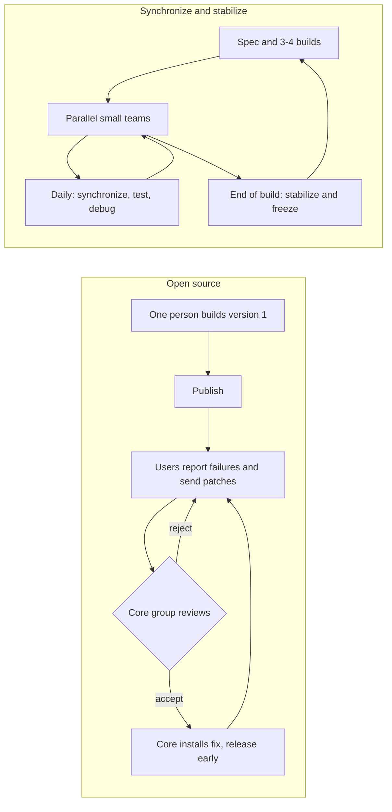

# Note 07 — Open-source and synchronize-and-stabilize models; choosing and mixing models

> Module 01 · Advanced Software Engineering · Term 1 · Farsi: [07-open-source-and-sync-stabilize.fa.md](07-open-source-and-sync-stabilize.fa.md) · Index: [INDEX.en.md](INDEX.en.md)

## 1. Summary

- The **open-source life-cycle model** has two informal phases: one person builds the first version; then users become co-maintainers (all of phase two is postdelivery maintenance). A **core group** controls changes, a **peripheral group** reports defects and sends patches (Schach 8e, ch. 2 §2.9.4).
- **Synchronize-and-stabilize** is Microsoft's iterative-and-incremental variant: small parallel teams **synchronize** (integrate, test, debug) every day and **stabilize** (fix, then freeze) at the end of each of three or four builds (ch. 2 §2.9.6).
- No model fits every project. Schach's advice is a **mix-and-match** model chosen for the organization, its management, its staff and the product (ch. 2 §2.10). Section 4 gives a decision table.

## 2. Detailed explanation

### Intuition

Open source has volunteers and no plan; Microsoft has thousands of paid developers and a ship date. Both keep many people's changes consistent, by different mechanisms: public review and a trusted core group, or a daily build.

### The open-source model (Schach 8e, ch. 2 §2.9.4)

**Phase one.** An individual has an idea and builds an initial version, then publishes it. If others find it useful, they start using it.

**Phase two.** Users become co-developers. Schach's observation is that everything they do is maintenance: reporting and fixing defects is **corrective**, adding functionality is **perfective**, porting is **adaptive**. So phase two "consists solely of postdelivery maintenance", and "co-developers" should really be "co-maintainers". Participation is voluntary and unpaid.

**Core and periphery.**

| | Core group | Peripheral group |
|---|---|---|
| Who | dedicated maintainers responsible for the project | users who are not in the core |
| Power | only they install fixes into the source | send defect reports (usually failure reports), sometimes fault reports and patches |
| Quality control | check each fix, decide or delegate it | use new versions and report what breaks |

A **failure report** says what behaviour was wrong. A **fault report** says where the code is wrong and how to fix it. Closed-source users can only send failure reports; open-source users with source access can send both.

**Release early, release often.** The core group releases as soon as a version is ready, with minimal testing, relying on the periphery to exercise it (Schach cites Raymond, 2000). This contrasts with the SQA-checked releases of closed-source projects. **Linus's law** (Raymond, as stated by Schach, ch. 1, p. 23): given enough eyeballs all bugs are shallow. Schach's own caveat (Box 1.6) is that it is closer to a truism than a guarantee: more reviewers help, but only if they actually review, and open-source developers tend to test less themselves.

**Structure.** Comparing the figures, Schach places the open-source model between code-and-fix and rapid prototyping: an initial working version exists and is reworked until it becomes the product, and there is generally **no specification or design**. It works when the core group is exceptionally skilled and the participants are themselves users (ch. 4 §4.7). Hence the restriction: successful mainly for **infrastructure software** (operating systems, browsers, compilers, web servers, databases). It is hard to imagine open-sourcing a product used in only one company.

### Synchronize-and-stabilize (ch. 2 §2.9.6, ch. 4 §4.5)

Microsoft builds large COTS products with this model (Cusumano and Selby, 1997, as cited by Schach; the book itself was not opened):

1. Interview prospective clients, list the highest-priority features, write a specification.
2. Divide the work into **three or four builds**, most critical features first.
3. Each build is made by several small parallel teams (3-8 developers plus 3-8 testers working one-to-one with them).
4. **Every day** all teams put their partial work together and test and debug it (**synchronize**). Developers must check in by a fixed time; breaking the build must be fixed immediately.
5. At the end of each build, fix remaining faults and **freeze** it (**stabilize**): no more specification changes in that build.

The daily integration keeps independently designed pieces working together and gives early insight into the product, so requirements can still change within a build, even when the initial specification was incomplete. Schach's caveat: no evidence it works outside Microsoft's culture; critics call it a way to let hackers build large products.

### Choosing and mixing models (ch. 2 §2.10)

Schach compares nine models and concludes (Figure 2.14): avoid code-and-fix; waterfall is a known quantity but may deliver the wrong product; rapid prototyping addresses that; open source and agile and synchronize-and-stabilize are context-dependent; the spiral needs risk-literate developers; the evolution-tree and iterative-and-incremental models are closest to real development. Then: each organization should pick a model suited to **the organization, its management, its employees and the product** and vary it by product, a **mix-and-match** model that keeps strengths and avoids weaknesses.

## 3. Diagram



## 4. Worked example

### 4a. Core vs periphery in a real project

Linux v6.18.63 publishes who maintains what in `MAINTAINERS`. A crude count (the status `Odd` is the file's `Odd Fixes`, cut short by the script's regex) with a scratch script (outside the repo):

```text
$ python -I maint_stats.py _shared/sources/linux/MAINTAINERS
subsystem entries (blocks with an S: line): 3123
M: lines: 4114; distinct maintainer e-mails: 1939
status: {'Maintained': 2104, 'Supported': 768, 'Orphan': 140, 'Odd': 106, 'Obsolete': 3, 'Externally': 1, 'Buried': 1}
```

Reading: over 3,000 subsystem entries share about 1,900 distinct maintainer addresses, so the "core" is large and divided by subsystem. 140 entries are `Orphan` (MAINTAINERS defines it as "No current maintainer"), which is the open-source version of a project with too few maintainers. The count is a rough proxy (e-mail addresses are not people; an entry may list several maintainers).

Linux also uses a time-boxed, stabilize-then-release rhythm, which resembles synchronize-and-stabilize at a much larger scale (the analogy is ours, not Linux's, and Microsoft's daily build has no Linux counterpart):

`linux/Documentation/process/2.Process.rst · "The big picture" · v6.18.63` (L49-L55)

```rst
The merge window lasts for approximately two weeks.  At the end of this
time, Linus Torvalds will declare that the window is closed and release the
first of the "rc" kernels.  For the kernel which is destined to be 5.6,
for example, the release which happens at the end of the merge window will
be called 5.6-rc1.  The -rc1 release is the signal that the time to
merge new features has passed, and that the time to stabilize the next
kernel has begun.
```

Same file, L67-L71:

```rst
As fixes make their way into the mainline, the patch rate will slow over
time.  Linus releases new -rc kernels about once a week; a normal series
will get up to somewhere between -rc6 and -rc9 before the kernel is
considered to be sufficiently stable and the final release is made.
At that point the whole process starts over again.
```

Line by line: the first sentence fixes the merge window (feature intake) at about two weeks, a **timebox** in the sense of note 06; "rc1" closes the window, so no new features are accepted (a **freeze**); weekly -rc releases are the **stabilization** loop; the final release restarts the cycle. For the full Linux vs OpenBSD comparison see the [case study](../case-study.en.md).

### 4b. Why daily integration is cheaper (illustrative simulation)

Parameters are assumptions: 8 teams, 30 days, 5% chance per team-day of introducing an integration fault, and a fault costs 20% more to fix for each day it stays hidden. Scratch script outside the repo:

```text
$ python -I sync_sim.py
8 teams, 30 days, P(fault per team-day) = 0.05, seed 7
integration faults introduced: 12
daily synchronize : mean age at detection 0.0 days, total fix cost 12.0 units
integrate at end  : mean age at detection 14.5 days, total fix cost 46.8 units
ratio end/daily   : 3.90x
over 1000 seeds    : mean ratio 3.92x (min 2.52, max 5.56)
```

This models the mechanism (cost of detection delay), not Microsoft; the ratio comes entirely from the assumed 20%-per-day growth.

### 4c. Decision table

| Context | Leans toward | Why (Schach 8e, ch. 2 §2.10 unless noted) |
|---|---|---|
| Organization: internal, large, can cancel projects cheaply | Spiral / UP | risk-driven cancellation is possible (§2.9.7) |
| Organization: external client under fixed contract | Rapid prototype then waterfall-like plan, or UP | risk analysis must happen before signing; client validates the prototype |
| Management: weak process control, level-1 maturity | Fix the process first (note 08) | new methods on chaos add chaos (ch. 3 §3.13) |
| Skills: small, senior, co-located team; vague requirements | Agile (XP/Scrum/Kanban) | works for small products with vague requirements |
| Skills: mixed levels, many teams | UP or synchronize-and-stabilize | needs architecture and a daily build to keep parts consistent |
| Product: infrastructure used by its own developers | Open source | core and periphery are users (§2.9.4) |
| Product: COTS, a fixed ship date, huge | Synchronize-and-stabilize | feature-ordered builds, daily integration |
| Product: safety-critical, regulated | Plan-driven + V-model/UP with agile practices inside | documentation and verification required (modern view; `OPINION / CONTESTED`) |
| Anything else | Mix-and-match | take proven features of each (Boehm and Turner, as cited by Schach) |

## 5. Edge cases and pitfalls

- **Open source is not "no process".** Linux documents its process (merge window, maintainers, review); see lab 07.
- **The core group is a bottleneck.** Only core members install fixes.
- **Minimal testing is a risk transfer.** It shifts defects to users. Acceptable for volunteers who chose the software, unacceptable for a hospital system.
- **Do not generalise from a few successes.** Schach stresses that neither Linux nor Microsoft proves the method works elsewhere; today continuous integration (note 08) makes "daily" unremarkable.

> **Schach says X; modern practice says Y.** Schach (2010) describes open source as having worked "in a small number of instances" with "limited applicability". Modern practice: open source is the substrate of almost all software stacks, with governance structures (foundations, maintainers, contribution guides) far beyond Schach's two informal phases; companies also run "inner source". The size of open source's role in a given sector is `UNVERIFIED` here (no survey opened).

## 6. Exam-style key points

- Open source: phase one = one person's first version; phase two = users as co-maintainers (corrective, perfective, adaptive maintenance only). No specifications or design.
- Core group installs fixes and ensures quality; peripheral group reports (mostly failure reports) and sometimes sends fault reports.
- "Release early, release often"; Linus's law: many eyeballs make bugs shallow (with caveats).
- Applies mainly to infrastructure software whose developers are its users; needs a superb core group and a superb motivator.
- Synchronize-and-stabilize: 3-4 builds, parallel small teams, daily synchronize, stabilize and freeze at the end of each build; works at Microsoft, unproven elsewhere.
- Choose by organization, management, employees and product; mix and match (ch. 2 §2.10).

## 7. Links

- Lesson: [§2.7 Can a project with no specification and no design succeed?](../lesson.en.md#27-can-a-project-with-no-specification-and-no-design-succeed) and [§2.11 Which model should we use?](../lesson.en.md#211-which-model-should-we-use)
- Case study: [§2 Release cycle: stabilization written as text](../case-study.en.md#2-release-cycle-stabilization-written-as-text) (Linux vs OpenBSD process).
- Previous: [06 Agile methods](06-agile-methods.en.md). Next: [08 Process improvement, DevOps, DORA](08-process-improvement-devops-dora.en.md).
- Lab: [07 Contributing guide](../labs/07-contributing-guide/README.md) (writes a `CONTRIBUTING.md` modelled on Linux practice).
- Quiz: questions 8, 12, 15 and oral question O2 in [quiz.en.md](../quiz.en.md).
- Sources: Schach 8e, ch. 2 §2.9.4, §2.9.6, §2.10; ch. 4 §4.5, §4.7; Linux `2.Process.rst` and `MAINTAINERS` at v6.18.63.

## Glossary

| Term | Meaning |
|---|---|
| Open-source life-cycle model | Informal two-phase model: initial version, then volunteer maintenance. |
| Core group | Maintainers who control and install changes in an open-source project. |
| Peripheral group | Users outside the core who report defects and send patches. |
| Failure report | Report of observed incorrect behaviour. |
| Fault report | Report that says where the code is wrong and how to correct it. |
| Linus's law | "Given enough eyeballs, all bugs are shallow" (Raymond). |
| Infrastructure software | Operating systems, compilers, web servers, databases and similar software its developers also use. |
| Synchronize | Daily integration, test and debug of all teams' partial work. |
| Stabilize | End-of-build bug fixing followed by a freeze. |
| Freeze | No further specification changes to a build. |
| COTS | Commercial off-the-shelf software. |
| Mix-and-match life-cycle model | A model assembled from the strengths of several models for a specific organization and product. |
| Orphan (MAINTAINERS) | A Linux subsystem entry with no current maintainer. |
