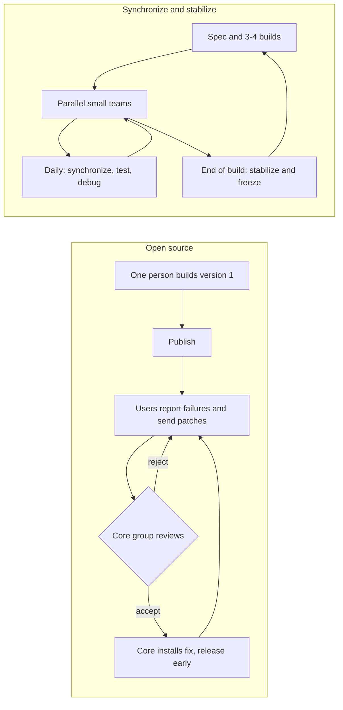

<div dir="rtl">

# یادداشت ۰۷ — مدل‌های open-source و synchronize-and-stabilize؛ انتخاب و ترکیب مدل‌ها

> ماژول ۰۱ · مهندسی نرم‌افزار پیشرفته · ترم ۱ · نسخهٔ انگلیسی: [`07-open-source-and-sync-stabilize.en.md`](07-open-source-and-sync-stabilize.en.md) · فهرست: [`INDEX.fa.md`](INDEX.fa.md)

## ۱. خلاصه

- **مدل چرخهٔ عمر open-source** دو phase غیررسمی دارد: یک نفر نسخهٔ اول را می‌سازد؛ بعد کاربران co-maintainer می‌شوند (کل phase دوم postdelivery maintenance است). **core group** تغییرها را کنترل می‌کند و **peripheral group** defect گزارش می‌دهد و patch می‌فرستد (`Schach 8e, ch. 2 §2.9.4`).
- **Synchronize-and-stabilize** گونهٔ iterative-and-incremental مایکروسافت است: تیم‌های کوچک موازی هر روز **synchronize** می‌کنند (integrate، test، debug) و در پایان هر یک از سه یا چهار build **stabilize** می‌کنند (رفع خطا و سپس freeze) (ch. 2 §2.9.6).
- هیچ مدلی برای همهٔ پروژه‌ها مناسب نیست. توصیهٔ Schach یک مدل **mix-and-match** است که برای سازمان، مدیریت، کارکنان و محصول انتخاب شود (ch. 2 §2.10). بخش ۴ یک جدول تصمیم می‌دهد.

## ۲. توضیح

### شهود

open source داوطلب دارد و برنامه ندارد؛ مایکروسافت هزاران توسعه‌دهندهٔ حقوق‌بگیر و تاریخ عرضه دارد. هر دو تغییرهای افراد زیادی را سازگار نگه می‌دارند، ولی با سازوکارهای متفاوت: review عمومی و core group قابل‌اعتماد، یا build روزانه.

### مدل open-source (`Schach 8e, ch. 2 §2.9.4`)

**Phase یک.** فردی ایده دارد و نسخهٔ اولیه را می‌سازد و منتشر می‌کند. اگر دیگران مفید بیابند، شروع به استفاده می‌کنند.

**Phase دو.** کاربران co-developer می‌شوند. مشاهدهٔ Schach این است که هر کاری که می‌کنند maintenance است: گزارش و رفع defect **corrective**، افزودن قابلیت **perfective** و port کردن **adaptive**. پس phase دوم «فقط از postdelivery maintenance تشکیل می‌شود» و «co-developer» در واقع باید «co-maintainer» نامیده شود. مشارکت داوطلبانه و بی‌مزد است.

**Core و periphery.**

| | Core group | Peripheral group |
|---|---|---|
| کیست | نگه‌دارندگان متعهد پروژه | کاربرانی که در core نیستند |
| اختیار | فقط آن‌ها fix را در source نصب می‌کنند | defect گزارش می‌دهند (معمولاً failure report)، گاهی fault report و patch |
| کنترل کیفیت | هر fix را بررسی می‌کنند و انجام یا واگذارش را تصمیم می‌گیرند | نسخه‌های جدید را به کار می‌برند و آنچه خراب می‌شود را گزارش می‌دهند |

**Failure report** می‌گوید چه رفتاری غلط بوده. **Fault report** می‌گوید کد کجا غلط است و چطور درست می‌شود. کاربران closed-source فقط failure report می‌فرستند؛ کاربران open-source با دسترسی به source هر دو را.

**Release early, release often.** core group به‌محض آماده شدن نسخه آن را با حداقل testing منتشر می‌کند و به periphery برای به‌کار بردن آن تکیه دارد (Schach به Raymond, 2000 ارجاع می‌دهد). این با releaseهای بررسی‌شده توسط SQA در پروژه‌های closed-source فرق دارد. **قانون لینوس** (Raymond، به بیان Schach، ch. 1، ص ۲۳): با چشم‌های کافی، همهٔ bugها سطحی‌اند. هشدار خود Schach (Box 1.6) این است که بیشتر یک بدیهیات است تا ضمانت: بازبین بیشتر کمک می‌کند ولی فقط اگر واقعاً review کنند، و توسعه‌دهندگان open-source خودشان کمتر test می‌کنند.

**ساختار.** Schach با مقایسهٔ شکل‌ها مدل open-source را بین code-and-fix و rapid prototyping می‌گذارد: یک نسخهٔ کارا هست و تا محصول شدن بازکاری می‌شود و معمولاً **نه specification هست نه design**. وقتی جواب می‌دهد که core group فوق‌العاده ماهر باشد و مشارکت‌کنندگان خودشان کاربر باشند (ch. 4 §4.7). از این‌رو محدودیت: عمدتاً برای **infrastructure software** موفق بوده (سیستم‌عامل، browser، compiler، web server، پایگاه داده). تصور open source شدن محصولی که فقط در یک شرکت استفاده می‌شود دشوار است.

### Synchronize-and-stabilize (ch. 2 §2.9.6، ch. 4 §4.5)

مایکروسافت محصول‌های COTS بزرگ را با این مدل می‌سازد (Cusumano و Selby, 1997 به نقل از Schach؛ خود کتاب باز نشد):

1. با مشتریان بالقوه مصاحبه، فهرست قابلیت‌های با اولویت بالا، نوشتن specification.
2. تقسیم کار به **سه یا چهار build**، قابلیت‌های حیاتی‌تر اول.
3. هر build را چند تیم کوچک موازی می‌سازند (۳ تا ۸ توسعه‌دهنده به‌علاوهٔ ۳ تا ۸ tester که یک‌به‌یک با آن‌ها کار می‌کنند).
4. **هر روز** همهٔ تیم‌ها کار نیمه‌تمام را کنار هم می‌گذارند و test و debug می‌کنند (**synchronize**). توسعه‌دهندگان باید تا ساعت معینی check-in کنند؛ شکستن build باید فوراً رفع شود.
5. در پایان هر build، خطاهای باقی‌مانده رفع و build **freeze** می‌شود (**stabilize**): دیگر تغییری در specification آن build نیست.

integration روزانه قطعه‌هایی را که مستقل طراحی شده‌اند سازگار نگه می‌دارد و بینش زودهنگام از محصول می‌دهد، پس requirements هنوز می‌توانند درون یک build تغییر کنند، حتی وقتی specification اولیه ناقص بوده. هشدار Schach: شاهدی نیست که بیرون از فرهنگ مایکروسافت کار کند؛ منتقدان آن را راهی می‌دانند تا گروهی hacker محصول بزرگ بسازند.

### انتخاب و ترکیب مدل‌ها (ch. 2 §2.10)

Schach نه مدل را مقایسه می‌کند و نتیجه می‌گیرد (Figure 2.14): از code-and-fix پرهیز کنید؛ waterfall شناخته‌شده است ولی ممکن است محصول اشتباه تحویل دهد؛ rapid prototyping به همین پاسخ می‌دهد؛ open source و agile و synchronize-and-stabilize وابسته به زمینه‌اند؛ spiral توسعه‌دهندگان آشنا با ریسک می‌خواهد؛ مدل‌های evolution-tree و iterative-and-incremental به توسعهٔ واقعی نزدیک‌ترند. بعد: هر سازمان باید مدلی متناسب با **سازمان، مدیریت، کارکنان و محصول** انتخاب کند و آن را بر حسب محصول تغییر دهد، یعنی مدل **mix-and-match** که نقاط قوت را نگه می‌دارد و ضعف‌ها را کنار می‌گذارد.

## ۳. نمودار

</div>



<div dir="rtl">

## ۴. مثال عملی

### 4a. core در برابر periphery در یک پروژهٔ واقعی

Linux v6.18.63 در `MAINTAINERS` منتشر می‌کند چه کسی نگه‌دار چیست. یک شمارش خام با اسکریپت scratch (بیرون از repo؛ وضعیت `Odd` همان `Odd Fixes` در فایل است که regex اسکریپت کوتاهش کرده):

</div>

```text
$ python -I maint_stats.py _shared/sources/linux/MAINTAINERS
subsystem entries (blocks with an S: line): 3123
M: lines: 4114; distinct maintainer e-mails: 1939
status: {'Maintained': 2104, 'Supported': 768, 'Orphan': 140, 'Odd': 106, 'Obsolete': 3, 'Externally': 1, 'Buried': 1}
```

<div dir="rtl">

خواندن: بیش از ۳٬۰۰۰ مدخل زیرسیستم میان حدود ۱٬۹۰۰ نشانی نگه‌دار متمایز تقسیم شده‌اند، پس «core» بزرگ است و بر حسب زیرسیستم تقسیم شده. ۱۴۰ مدخل `Orphan` است (MAINTAINERS آن را «No current maintainer» تعریف می‌کند)، که نسخهٔ open-source پروژه‌ای با نگه‌دارندهٔ کم است. این شمارش یک تقریب خام است (نشانی ایمیل برابر آدم نیست و یک مدخل ممکن است چند نگه‌دار داشته باشد).

Linux همچنین ریتم زمان‌بندی‌شدهٔ «stabilize و بعد release» دارد که به synchronize-and-stabilize در مقیاس بسیار بزرگ‌تر شبیه است (این تشبیه از ماست نه از Linux، و build روزانهٔ مایکروسافت در Linux همتا ندارد):

`linux/Documentation/process/2.Process.rst · "The big picture" · v6.18.63` (L49-L55)

</div>

```rst
The merge window lasts for approximately two weeks.  At the end of this
time, Linus Torvalds will declare that the window is closed and release the
first of the "rc" kernels.  For the kernel which is destined to be 5.6,
for example, the release which happens at the end of the merge window will
be called 5.6-rc1.  The -rc1 release is the signal that the time to
merge new features has passed, and that the time to stabilize the next
kernel has begun.
```

<div dir="rtl">

همان فایل، L67-L71:

</div>

```rst
As fixes make their way into the mainline, the patch rate will slow over
time.  Linus releases new -rc kernels about once a week; a normal series
will get up to somewhere between -rc6 and -rc9 before the kernel is
considered to be sufficiently stable and the final release is made.
At that point the whole process starts over again.
```

<div dir="rtl">

خط به خط: جملهٔ اول merge window (پذیرش قابلیت) را حدود دو هفته تعیین می‌کند، یک **timebox** به معنی یادداشت ۰۶؛ «rc1» پنجره را می‌بندد، پس قابلیت تازه پذیرفته نمی‌شود (یک **freeze**)؛ releaseهای هفتگی -rc حلقهٔ **stabilization** هستند؛ release نهایی چرخه را از نو شروع می‌کند. برای مقایسهٔ کامل Linux و OpenBSD [case study](../case-study.fa.md) را ببینید.

### 4b. چرا integration روزانه ارزان‌تر است (شبیه‌سازی توضیحی)

پارامترها فرض‌اند: ۸ تیم، ۳۰ روز، ۵٪ احتمال هر تیم-روز برای ایجاد fault در integration، و هر روزی که fault پنهان بماند ۲۰٪ به هزینهٔ رفعش اضافه می‌شود. اسکریپت scratch بیرون از repo:

</div>

```text
$ python -I sync_sim.py
8 teams, 30 days, P(fault per team-day) = 0.05, seed 7
integration faults introduced: 12
daily synchronize : mean age at detection 0.0 days, total fix cost 12.0 units
integrate at end  : mean age at detection 14.5 days, total fix cost 46.8 units
ratio end/daily   : 3.90x
over 1000 seeds    : mean ratio 3.92x (min 2.52, max 5.56)
```

<div dir="rtl">

این سازوکار (هزینهٔ تأخیر در کشف) را مدل می‌کند، نه مایکروسافت را؛ نسبت کاملاً از رشد فرضی ۲۰٪ در روز می‌آید.

### 4c. جدول تصمیم

| زمینه | گرایش به | چرا (`Schach 8e, ch. 2 §2.10` مگر خلاف آن گفته شود) |
|---|---|---|
| سازمان: داخلی، بزرگ، لغو پروژه ارزان | Spiral / UP | لغو بر پایهٔ ریسک ممکن است (§2.9.7) |
| سازمان: مشتری بیرونی با قرارداد ثابت | rapid prototype و بعد برنامهٔ waterfall-مانند، یا UP | risk analysis باید پیش از امضا انجام شود؛ مشتری prototype را validate می‌کند |
| مدیریت: کنترل ضعیف فرایند، بلوغ سطح ۱ | اول فرایند را درست کنید (یادداشت ۰۸) | روش تازه روی هرج‌ومرج هرج‌ومرج می‌افزاید (ch. 3 §3.13) |
| مهارت: تیم کوچک، ارشد، هم‌مکان؛ requirements مبهم | Agile (XP/Scrum/Kanban) | برای محصول‌های کوچک با requirements مبهم کار می‌کند |
| مهارت: سطوح مختلط، تیم‌های زیاد | UP یا synchronize-and-stabilize | معماری و build روزانه برای سازگار ماندن قطعه‌ها لازم است |
| محصول: infrastructure که خود توسعه‌دهندگانش کاربرند | Open source | core و periphery کاربرند (§2.9.4) |
| محصول: COTS، تاریخ عرضهٔ ثابت، بسیار بزرگ | Synchronize-and-stabilize | buildهای مرتب‌شده بر حسب قابلیت، integration روزانه |
| محصول: safety-critical و مقررات‌دار | plan-driven + V-model/UP با عملکردهای agile درون آن | مستندات و verification لازم است (دید امروزی؛ `OPINION / CONTESTED`) |
| هر چیز دیگر | Mix-and-match | ویژگی‌های اثبات‌شدهٔ هر مدل را بردارید (Boehm و Turner، به نقل از Schach) |

## ۵. حالت‌های خاص و دام‌ها

- **open source یعنی «بدون فرایند» نیست.** Linux فرایندش را مستند کرده (merge window، maintainers، review)؛ آزمایش ۰۷ را ببینید.
- **core group گلوگاه است.** فقط اعضای core fix نصب می‌کنند.
- **از چند موفقیت تعمیم ندهید.** Schach تأکید می‌کند نه Linux و نه مایکروسافت ثابت نمی‌کنند روش جای دیگر کار می‌کند؛ امروز continuous integration (یادداشت ۰۸) «روزانه» را عادی کرده.

> **Schach می‌گوید X؛ رویهٔ امروز می‌گوید Y.** Schach (۲۰۱۰) open source را «در تعداد کمی از موارد» موفق و با «کاربرد محدود» توصیف می‌کند. رویهٔ امروز: open source زیربنای تقریباً همهٔ stackهای نرم‌افزاری است، با ساختارهای حاکمیتی (بنیادها، maintainerها، راهنمای مشارکت) بسیار فراتر از دو phase غیررسمی Schach؛ شرکت‌ها «inner source» هم اجرا می‌کنند. اندازهٔ نقش open source در یک بخش مشخص اینجا `UNVERIFIED` است (پیمایشی باز نشد).

## ۶. نکته‌های کلیدی امتحانی

- Open source: phase یک = نسخهٔ اول یک نفر؛ phase دو = کاربران به‌عنوان co-maintainer (فقط maintenance از نوع corrective، perfective، adaptive). specification و design نیست.
- core group fix را نصب و کیفیت را تضمین می‌کند؛ periphery گزارش می‌دهد (بیشتر failure report) و گاهی fault report می‌فرستد.
- «Release early, release often»؛ قانون لینوس: چشم‌های بیشتر یعنی bugهای سطحی‌تر (با قید و شرط).
- عمدتاً برای infrastructure software که توسعه‌دهندگانش کاربر آن‌اند؛ core group بسیار ماهر و یک محرک عالی می‌خواهد.
- Synchronize-and-stabilize: ۳ تا ۴ build، تیم‌های کوچک موازی، synchronize روزانه، stabilize و freeze در پایان هر build؛ در مایکروسافت جواب داده، جای دیگر اثبات نشده.
- انتخاب بر پایهٔ سازمان، مدیریت، کارکنان و محصول؛ mix and match (ch. 2 §2.10).

## ۷. پیوندها

- درس: [بخش ۲.۷ آیا پروژه‌ای بدون specification و design موفق می‌شود؟](../lesson.fa.md) و [بخش ۲.۱۱ کدام مدل را به کار ببریم؟](../lesson.fa.md)
- Case study: [بخش ۲ چرخهٔ release: stabilization به‌صورت متن](../case-study.fa.md) (فرایند Linux در برابر OpenBSD).
- قبلی: [۰۶ روش‌های agile](06-agile-methods.fa.md). بعدی: [۰۸ بهبود فرایند، DevOps، DORA](08-process-improvement-devops-dora.fa.md).
- آزمایش: [۰۷ راهنمای مشارکت](../labs/07-contributing-guide/README.md) (یک `CONTRIBUTING.md` به الگوی عملکرد Linux می‌نویسد).
- آزمونک: پرسش‌های ۸، ۱۲، ۱۵ و پرسش شفاهی O2 در [`quiz.fa.md`](../quiz.fa.md).
- منابع: Schach 8e, ch. 2 §2.9.4، §2.9.6، §2.10؛ ch. 4 §4.5، §4.7؛ `2.Process.rst` و `MAINTAINERS` در Linux v6.18.63.

## واژه‌نامه

| اصطلاح | تعریف |
|---|---|
| **Open-source life-cycle model** | مدل غیررسمی دو phase: نسخهٔ اولیه، سپس maintenance داوطلبانه. |
| **Core group** | نگه‌دارندگانی که تغییرها را در پروژهٔ open-source کنترل و نصب می‌کنند. |
| **Peripheral group** | کاربران بیرون از core که defect گزارش می‌دهند و patch می‌فرستند. |
| **Failure report** | گزارش رفتار نادرست مشاهده‌شده. |
| **Fault report** | گزارشی که می‌گوید کد کجا غلط است و چطور اصلاح می‌شود. |
| **Linus's law** | «با چشم‌های کافی، همهٔ bugها سطحی‌اند» (Raymond). |
| **Infrastructure software** | سیستم‌عامل، compiler، web server، پایگاه داده و مانند آن‌ها که توسعه‌دهندگانش خودشان هم کاربرند. |
| **Synchronize** | integration، test و debug روزانهٔ کار نیمه‌تمام همهٔ تیم‌ها. |
| **Stabilize** | رفع bug در پایان build و سپس freeze. |
| **Freeze** | هیچ تغییر دیگری در specification یک build. |
| **COTS** | نرم‌افزار تجاری آماده (commercial off-the-shelf). |
| **Mix-and-match life-cycle model** | مدلی که از نقاط قوت چند مدل برای یک سازمان و محصول مشخص ساخته می‌شود. |
| **Orphan (MAINTAINERS)** | مدخل زیرسیستم Linux بدون نگه‌دارندهٔ فعلی. |

</div>
