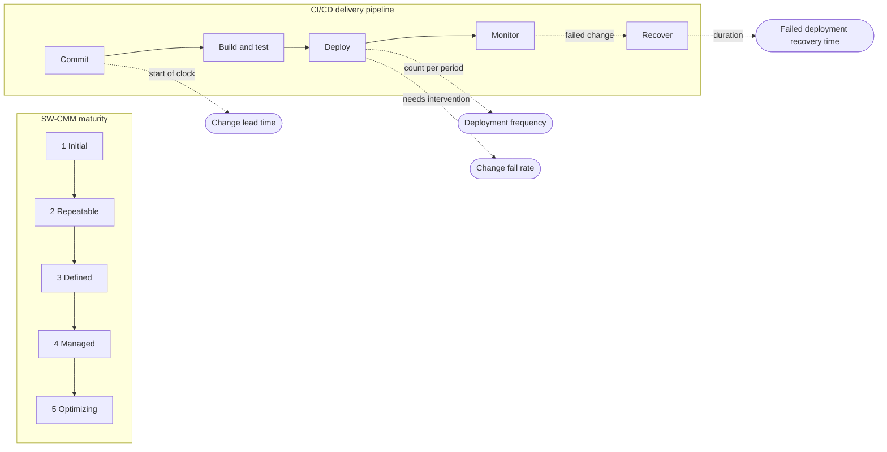

# Note 08 — Process improvement, teams, DevOps and DORA metrics

> Module 01 · Advanced Software Engineering · Term 1 · Farsi: [08-process-improvement-devops-dora.fa.md](08-process-improvement-devops-dora.fa.md) · Index: [INDEX.en.md](INDEX.en.md)

## 1. Summary

- **Process improvement** (SW-CMM, CMMI, ISO/IEC 15504 "SPICE", ISO 9000) improves how an organization manages its process, whatever life-cycle model it uses. SW-CMM has five maturity levels; Schach reports payoffs of several dollars per dollar invested (Schach 8e, ch. 3 §3.12-§3.15).
- **Team organization** is a managerial choice: democratic teams, chief programmer teams, modern team-leader plus team-manager hierarchies, and the fact that adding people to a late project makes it later (**Brooks's law**, ch. 4).
- **DevOps** with continuous integration and delivery measures itself with the **DORA metrics**: deployment frequency, lead time for changes, change failure rate, and time to restore service. These are absent from Schach; the DORA page itself now lists five (section 2).

## 2. Detailed explanation

### Intuition

You can adopt Scrum or the UP and still fail because nobody measures, plans or reviews. Process improvement assumes the problem is mostly management. DORA is the modern answer: measure delivery outcomes directly instead of auditing against a maturity ladder.

### SW-CMM and CMMI (Schach 8e, ch. 3 §3.13)

The Capability Maturity Model for Software was first proposed by Watts Humphrey in 1986 at the SEI (Carnegie Mellon, founded by the U.S. DoD). It is a **framework**, not a life-cycle model: it recommends no specific method. Its premise is that the problem is how the process is managed. It defines five levels, entered one at a time:

| Level | Name | Description (Schach) | Key process areas (Figure 3.3) |
|---|---|---|---|
| 1 | Initial | ad hoc, crisis-driven; outcome depends on the people | none |
| 2 | Repeatable | basic project management; costs and schedules are measured | requirements management, project planning, project tracking, subcontract management, SQA, configuration management |
| 3 | Defined | process fully documented, reviews used for quality; new technology (CASE) makes sense here | process definition and focus, training, integrated management, software product engineering, intergroup coordination, peer reviews |
| 4 | Managed | quality and productivity goals set and measured, statistical control | quantitative process management, software quality management |
| 5 | Optimizing | continuous improvement, feedback loop from every project | defect prevention, technology change management, process change management |

Schach reports that moving up one level usually takes 18 months to 3 years, and 1 to 2 can take 3 to 5 years. Level 5 includes fault *prevention*; level 2 is concerned with detecting and correcting faults. **CMMI** was decided in 1997 to integrate five maturity models (software, people, systems engineering, integrated product development, acquisition) into one framework (reference: SEI, 2002, as cited by Schach). What CMMI looks like today (current version, whether "levels" are still the headline, how appraisals work) is `VERSION-DEPENDENT` and `UNVERIFIED` here: no SEI/CMMI Institute page was opened.

**Other initiatives.** ISO 9000 (ISO 9000-3 for software) is not software-specific and reduces the risk of poor quality without guaranteeing it. **ISO/IEC 15504** is the international standard formerly called **SPICE** (Software Process Improvement Capability dEtermination), initiated by the UK Ministry of Defence, first version 1995, taken over by ISO/IEC in 1997 (Schach §3.14). Later renumbering and successors (the ISO/IEC 330xx family) are `UNVERIFIED` here.

**Costs and benefits (§3.15).** Reported results, all secondhand through Schach: Hughes Aircraft spent about $500,000 (1987-1990) to move from level 2 to 3 and estimated savings of about $2 million a year; Raytheon (level 1 to 3, 1988-1993) doubled productivity and reported $7.70 returned per dollar; Galin and Avrahami (2006), 85 projects: median ROI 360% (range 120-650%). Motorola's 34 projects (Figure 3.4) show fewer faults per million equivalent assembler lines at higher levels (890 at level 2, 126 at level 5). These are company-reported results; selection bias is likely. `OPINION / CONTESTED`: the claim that maturity causes quality.

### Teams (Schach 8e, ch. 4)

| Organization | Idea | Strength | Weakness |
|---|---|---|---|
| Democratic (Weinberg, "egoless programming") | up to ~10 peers, code belongs to the team, finding faults is good news | positive attitude to fault finding; good for hard problems | experienced staff resent review by beginners; cannot be imposed; managers dislike it |
| Classical chief programmer (Mills/Baker, 1971) | surgeon-style hierarchy: chief, backup, programming secretary, 1-3 programmers | communication paths minimal; one famous success (New York Times project) | needs a rare person who is both top manager and top programmer; impractical |
| Modern hierarchy (§4.4) | split chief into **team leader** (technical) and **team manager** (non-technical) | scales up; managers do not attend reviews | areas of responsibility must be delineated |
| Others | synchronize-and-stabilize (§4.5), agile pairs (§4.6), open source (§4.7) | see notes 06 and 07 | limited evidence |

**Brooks's law.** Adding people to a late software project makes it later. Schach attributes it to Fred Brooks, who observed it managing OS/360 development (Brooks, *The Mythical Man-Month*, 1975, as cited in Schach ch. 4 §4.1; the book itself was not opened). The mechanism is communication: new members must be brought up to date, and channels grow with team size. Two-person channels grow as n(n-1)/2.

### DevOps, CI/CD and DORA metrics (not in Schach)

**DevOps** (working definition for this course; no single standard source was opened): development and operations share responsibility for delivering and running software, supported by automation. **Continuous integration (CI)** merges small changes into a shared mainline frequently and verifies each with an automated build and tests; this is the descendant of synchronize-and-stabilize's daily build and XP's continuous integration. **Continuous delivery (CD)**: the DORA site defines it as "the ability to release changes of all kinds on demand quickly, safely, and sustainably" and lists test automation, deployment automation, trunk-based development, continuous integration and version control among its practices (dora.dev/capabilities/continuous-delivery, opened for this note; the page carries no date).

**DORA metrics.** DORA is the research program run by Google Cloud (dora.dev/research, opened; report archives are listed for 2014-2025). The four metrics that made it famous are usually attributed to Forsgren, Humble and Kim, *Accelerate* (2018); the book was **not opened** for this note, so the attribution and the original wording are `UNVERIFIED`. The metrics page (dora.dev/guides/dora-metrics, last updated January 5, 2026) currently lists **five** metrics in two groups, and says they evolved from the original four-key model:

| Group | Metric | Definition on the page |
|---|---|---|
| Throughput | Change lead time | time from committed to version control to deployed in production |
| Throughput | Deployment frequency | number of deployments over a period, or time between deployments |
| Throughput | Failed deployment recovery time | time to recover from a deployment that fails and needs immediate intervention |
| Instability | Change fail rate | ratio of deployments that need immediate intervention after deployment |
| Instability | Deployment rework rate | ratio of deployments that are unplanned, caused by a production incident |

`VERSION-DEPENDENT`: the older "time to restore service" (MTTR) is now "failed deployment recovery time", and "deployment rework rate" is a newer addition. The assignment's four-metric list matches the 2018-era version; for any exam, state which version you use.

## 3. Diagram



## 4. Worked example

Two small computations, both verifiable.

**(a) DORA metrics from a deployment log.** The log is synthetic (8 deployments in 17 days, two of them failures). Lab 01 does the same on real Git history. Scratch script outside the repo, using the page definitions above:

```text
$ python -I dora_brooks.py
period: 17 days, deployments: 8
deployment frequency     : 3.3 per week
change lead time (median): 22.7 h (mean 20.7 h)
change fail rate         : 25%
failed deploy recovery   : median 2.0 h over 2 failures
```

Reading: median lead time is about a day. The 25% fail rate rests on 2 failures in 8 deployments, which is statistically meaningless; a real report needs many more. The median is used because lead-time distributions are skewed. Read throughput and instability together: deploying often but failing often is not improvement.

**(b) Brooks's law arithmetic.** Same script, second part. It reproduces the numbers in Schach ch. 4 (three people: 3 channels; six people: 15 channels; 57 groups of two to six people):

```text
Brooks's law arithmetic (two-person channels n(n-1)/2):
   3 people ->   3 channels
   4 people ->   6 channels
   6 people ->  15 channels
  10 people ->  45 channels
  20 people -> 190 channels
groups of 2..6 among 6 people: 57 (Schach 8e, ch.4 s4.3 states 57)
```

Reading: going from 3 to 4 people doubles the channels (3 to 6) while adding 33% capacity. Schach's chief programmer team (Figure 4.3) has 6 people but only 5 lines, because all interfaces go through the chief.

## 5. Edge cases and pitfalls

- **Maturity is not agility.** Level 3 means a documented, repeated process, not a good one.
- **DORA metrics are for improving teams, not ranking people.** Targets with rewards invite gaming. `OPINION / CONTESTED`; no source opened.
- **"Deployment" and lead-time start need definitions** (staging? feature flag? first commit or pull request?). State your convention, as lab 01 does.
- **Brooks's law has limits.** It is about late projects and tasks that cannot be partitioned; adding people early, or to a well-partitioned task, can help (strawberry picking vs elephant gestation in Schach's analogy).

> **Schach says X; modern practice says Y.** Schach (2010): process quality is improved by maturity models (CMM/CMMI, ISO/IEC 15504) and teams are organized democratic/chief-programmer; delivery speed and operations are not discussed. Modern practice: DevOps culture, CI/CD pipelines and the DORA metrics are the common frame for delivery performance; maturity models remain in contracting and regulated sectors. Which one improves outcomes more is `OPINION / CONTESTED`.

## 6. Exam-style key points

- SW-CMM levels: 1 Initial, 2 Repeatable, 3 Defined, 4 Managed, 5 Optimizing; KPAs at level 2 include project planning, tracking, configuration management, SQA, requirements management.
- Level 2 = detect and correct faults; level 5 = prevent them. Moving up a level typically takes 18 months to 3 years.
- CMM is a process-improvement framework independent of the life-cycle model; CMMI merges five maturity models (decided 1997).
- ISO/IEC 15504 = SPICE; ISO 9000 is not software specific.
- Reported benefits (Schach): Raytheon $7.70 per dollar; Galin and Avrahami median ROI 360% over 85 projects.
- Democratic team (egoless), chief programmer team, modern team leader plus team manager; chief programmer is impractical.
- Brooks's law: adding people to a late software project makes it later (Brooks, 1975); communication channels n(n-1)/2.
- DORA: deployment frequency, change (lead) time, change fail rate, recovery time (plus rework rate in the 2026 page); state the version you cite.
- CI: frequent integration with automated build and tests; CD: release on demand.

## 7. Links

- Lesson: [§2.8 How do we know whether a process change helped?](../lesson.en.md#28-how-do-we-know-whether-a-process-change-helped), [§2.9 Is DevOps a tool?](../lesson.en.md#29-is-devops-a-tool), [§2.10 Why does adding programmers to a late project make it later?](../lesson.en.md#210-why-does-adding-programmers-to-a-late-project-make-it-later)
- Previous: [07 Open source, synchronize-and-stabilize](07-open-source-and-sync-stabilize.en.md). Index: [INDEX.en.md](INDEX.en.md).
- Labs: [01 DORA metrics](../labs/01-dora-metrics/README.md), [02 CI quality gates](../labs/02-ci-quality-gates/README.md).
- Quiz: questions 7, 11, 13 and oral question O3 in [quiz.en.md](../quiz.en.md).
- Sources: Schach 8e, ch. 3 §3.12-§3.15; ch. 4 §4.1-§4.4, §4.8. Opened online: dora.dev/guides/dora-metrics (updated 2026-01-05), dora.dev/capabilities/continuous-delivery, dora.dev/research. Not opened: *Accelerate* (2018), SEI/CMMI Institute material, Brooks 1975.

## Glossary

| Term | Meaning |
|---|---|
| Process improvement | Deliberate effort to improve how software is produced and managed. |
| SW-CMM | Capability Maturity Model for software: five levels of process maturity. |
| CMMI | Capability Maturity Model Integration: one framework replacing several maturity models. |
| Key process area (KPA) | Group of related goals an organization must meet to reach a CMM level. |
| ISO/IEC 15504 (SPICE) | International standard for process assessment and improvement. |
| Democratic team | Egoless programming team of peers. |
| Chief programmer team | Hierarchical team under one responsible, highly skilled programmer. |
| Brooks's law | Adding people to a late software project makes it later. |
| DevOps | Shared responsibility of development and operations with automation (course working definition). |
| Continuous integration (CI) | Frequent merging of changes with automated build and tests. |
| Continuous delivery (CD) | Ability to release changes on demand quickly, safely, sustainably (dora.dev). |
| Deployment frequency | How often deployments happen. |
| Change lead time | Time from commit to running in production. |
| Change fail rate | Share of deployments that need immediate intervention. |
| Failed deployment recovery time | Time to recover from a failed deployment (formerly time to restore service). |
