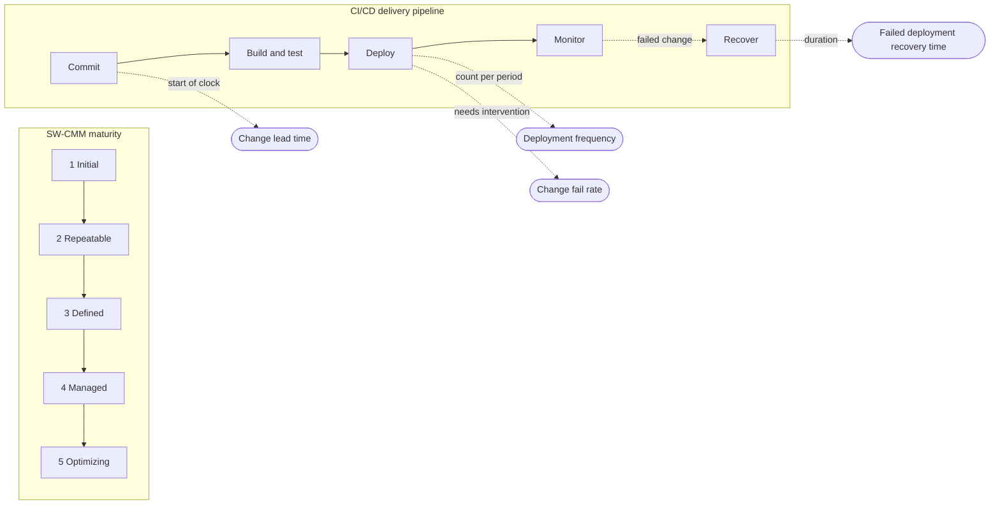

<div dir="rtl">

# یادداشت ۰۸ — بهبود فرایند، تیم‌ها، DevOps و معیارهای DORA

> ماژول ۰۱ · مهندسی نرم‌افزار پیشرفته · ترم ۱ · نسخهٔ انگلیسی: [`08-process-improvement-devops-dora.en.md`](08-process-improvement-devops-dora.en.md) · فهرست: [`INDEX.fa.md`](INDEX.fa.md)

## ۱. خلاصه

- **بهبود فرایند** (SW-CMM، CMMI، ISO/IEC 15504 یا «SPICE»، ISO 9000) نحوهٔ مدیریت فرایند در سازمان را بهتر می‌کند، با هر life-cycle model. SW-CMM پنج سطح بلوغ دارد؛ Schach بازدهی چند دلار به‌ازای هر دلار سرمایه‌گذاری را گزارش می‌کند (`Schach 8e, ch. 3 §3.12`-`§3.15`).
- **سازمان‌دهی تیم** یک انتخاب مدیریتی است: تیم‌های democratic، chief programmer، سلسله‌مراتب‌های مدرن team-leader به‌علاوهٔ team-manager، و این واقعیت که افزودن آدم به پروژهٔ دیرکرده آن را دیرتر می‌کند (**قانون Brooks**، ch. 4).
- **DevOps** با continuous integration و delivery خود را با **معیارهای DORA** می‌سنجد: deployment frequency، lead time for changes، change failure rate و time to restore service. این‌ها در Schach نیستند؛ صفحهٔ خود DORA امروز پنج معیار می‌آورد (بخش ۲).

## ۲. توضیح

### شهود

می‌شود Scrum یا UP را به کار برد و باز هم شکست خورد چون کسی اندازه نمی‌گیرد، برنامه نمی‌ریزد و review نمی‌کند. بهبود فرایند فرض می‌کند مشکل بیشتر مدیریتی است. DORA پاسخ امروزی است: به‌جای ممیزی در برابر نردبان بلوغ، نتیجه‌های تحویل را مستقیم بسنج.

### SW-CMM و CMMI (`Schach 8e, ch. 3 §3.13`)

Capability Maturity Model برای نرم‌افزار را نخستین بار Watts Humphrey در ۱۹۸۶ در SEI پیشنهاد داد (Carnegie Mellon، تأسیس‌شده توسط وزارت دفاع آمریکا). یک **چارچوب** است، نه life-cycle model: هیچ روش مشخصی را توصیه نمی‌کند. فرضش این است که مشکل در نحوهٔ مدیریت فرایند است. پنج سطح تعریف می‌کند که یکی‌یکی طی می‌شوند:

| سطح | نام | توصیف (Schach) | Key process areaها (Figure 3.3) |
|---|---|---|---|
| 1 | Initial | ad hoc و بحران‌محور؛ نتیجه به افراد بستگی دارد | ندارد |
| 2 | Repeatable | مدیریت پروژهٔ پایه؛ هزینه و زمان‌بندی اندازه‌گیری می‌شود | requirements management، project planning، project tracking، subcontract management، SQA، configuration management |
| 3 | Defined | فرایند کاملاً مستند، review برای کیفیت؛ فناوری تازه (CASE) اینجا معنا دارد | process definition و focus، training، integrated management، software product engineering، intergroup coordination، peer reviews |
| 4 | Managed | هدف‌های کیفیت و productivity تعیین و اندازه‌گیری می‌شوند، کنترل آماری | quantitative process management، software quality management |
| 5 | Optimizing | بهبود مداوم، حلقهٔ بازخورد از هر پروژه | defect prevention، technology change management، process change management |

Schach گزارش می‌کند بالا رفتن یک سطح معمولاً ۱۸ ماه تا ۳ سال طول می‌کشد و از ۱ به ۲ گاهی ۳ تا ۵ سال. سطح ۵ شامل *پیشگیری* از fault است؛ سطح ۲ به کشف و رفع fault می‌پردازد. **CMMI** در ۱۹۹۷ تصمیم گرفته شد تا پنج مدل بلوغ (نرم‌افزار، نیروی انسانی، مهندسی سیستم، توسعهٔ یکپارچهٔ محصول، تدارک) را در یک چارچوب ادغام کند (مرجع: SEI, 2002، به نقل از Schach). اینکه CMMI امروز چه شکلی دارد (نسخهٔ فعلی، آیا «سطح‌ها» هنوز عنوان اصلی‌اند، ارزیابی چگونه است) `VERSION-DEPENDENT` و اینجا `UNVERIFIED` است: صفحه‌ای از SEI/CMMI Institute باز نشد.

**ابتکارهای دیگر.** ISO 9000 (و ISO 9000-3 برای نرم‌افزار) مخصوص نرم‌افزار نیست و خطر کیفیت بد را کم می‌کند بی‌آنکه ضمانتش کند. **ISO/IEC 15504** استاندارد بین‌المللی است که قبلاً **SPICE** (Software Process Improvement Capability dEtermination) نام داشت؛ وزارت دفاع بریتانیا آن را آغاز کرد، نسخهٔ اول ۱۹۹۵، و در ۱۹۹۷ ISO/IEC تحویلش گرفت (Schach §3.14). شماره‌گذاری‌های بعدی و جانشین‌ها (خانوادهٔ ISO/IEC 330xx) اینجا `UNVERIFIED` است.

**هزینه‌ها و فایده‌ها (§3.15).** نتایج گزارش‌شده، همه دست‌دوم از طریق Schach: Hughes Aircraft حدود ۵۰۰٬۰۰۰ دلار (۱۹۸۷ تا ۱۹۹۰) خرج کرد تا از سطح ۲ به ۳ برسد و صرفه‌جویی سالانه را حدود ۲ میلیون دلار برآورد کرد؛ Raytheon (سطح ۱ به ۳، ۱۹۸۸ تا ۱۹۹۳) productivity را دو برابر کرد و ۷٫۷۰ دلار بازده به‌ازای هر دلار گزارش داد؛ Galin و Avrahami (2006)، ۸۵ پروژه: ROI میانه ۳۶۰٪ (بازهٔ ۱۲۰ تا ۶۵۰٪). ۳۴ پروژهٔ Motorola (Figure 3.4) در سطح‌های بالاتر fault کمتری به‌ازای هر میلیون خط معادل assembler نشان می‌دهند (۸۹۰ در سطح ۲، ۱۲۶ در سطح ۵). این‌ها نتایج گزارش‌شدهٔ خود شرکت‌هاست؛ سوگیری انتخاب محتمل است. `OPINION / CONTESTED`: ادعای اینکه بلوغ علت کیفیت است.

### تیم‌ها (Schach 8e, ch. 4)

| سازمان‌دهی | ایده | قوت | ضعف |
|---|---|---|---|
| Democratic (Weinberg، «egoless programming») | تا حدود ۱۰ همتا، کد مال تیم است، پیدا کردن fault خبر خوب است | نگرش مثبت به fault یابی؛ برای مسئله‌های سخت خوب | کارکنان باتجربه از بازبینی توسط تازه‌کارها ناراضی‌اند؛ تحمیل‌پذیر نیست؛ مدیران دوستش ندارند |
| Chief programmer کلاسیک (Mills/Baker، ۱۹۷۱) | سلسله‌مراتب جراح‌گونه: chief، backup، programming secretary، ۱ تا ۳ برنامه‌نویس | کمترین مسیر ارتباطی؛ یک موفقیت مشهور (پروژهٔ New York Times) | فردی نادر لازم است که هم مدیر ممتاز باشد هم برنامه‌نویس ممتاز؛ غیرعملی |
| سلسله‌مراتب مدرن (§4.4) | chief را به **team leader** (فنی) و **team manager** (غیرفنی) تقسیم کن | scale می‌شود؛ مدیران در reviewها حاضر نمی‌شوند | حوزه‌های مسئولیت باید مشخص شوند |
| بقیه | synchronize-and-stabilize (§4.5)، pairهای agile (§4.6)، open source (§4.7) | یادداشت‌های ۰۶ و ۰۷ | شواهد محدود |

**قانون Brooks.** افزودن آدم به پروژهٔ نرم‌افزاری دیرکرده آن را دیرتر می‌کند. Schach آن را به Fred Brooks نسبت می‌دهد که هنگام مدیریت توسعهٔ OS/360 مشاهده‌اش کرد (Brooks، *The Mythical Man-Month*، ۱۹۷۵، به نقل از Schach ch. 4 §4.1؛ خود کتاب باز نشد). سازوکار، ارتباط است: اعضای تازه باید در جریان قرار بگیرند و کانال‌ها با اندازهٔ تیم رشد می‌کنند. کانال‌های دونفره به‌صورت n(n-1)/2 رشد می‌کنند.

### DevOps، CI/CD و معیارهای DORA (در Schach نیست)

**DevOps** (تعریف کاری این درس؛ هیچ منبع استاندارد واحدی باز نشد): توسعه و عملیات مسئولیت تحویل و اجرای نرم‌افزار را مشترکاً بر عهده دارند، با پشتیبانی اتوماسیون. **Continuous integration (CI)** تغییرهای کوچک را مکرر در mainline مشترک ادغام می‌کند و هر کدام را با build و test خودکار verify می‌کند؛ این نوادهٔ build روزانهٔ synchronize-and-stabilize و continuous integration در XP است. **Continuous delivery (CD)**: سایت DORA آن را «توانایی انتشار تغییرهای هر نوع، در صورت نیاز، سریع، ایمن و پایدار» تعریف می‌کند («the ability to release changes of all kinds on demand quickly, safely, and sustainably») و test automation، deployment automation، trunk-based development، continuous integration و version control را در میان عملکردهایش می‌شمارد (dora.dev/capabilities/continuous-delivery، برای این یادداشت باز شد؛ صفحه تاریخ ندارد).

**معیارهای DORA.** DORA برنامهٔ پژوهشی Google Cloud است (dora.dev/research، باز شد؛ بایگانی گزارش‌ها برای ۲۰۱۴ تا ۲۰۲۵ فهرست شده). چهار معیاری که مشهورش کردند معمولاً به Forsgren، Humble و Kim، *Accelerate* (۲۰۱۸) نسبت داده می‌شوند؛ کتاب **باز نشد**، پس این نسبت و عبارت‌بندی اصلی `UNVERIFIED` است. صفحهٔ معیارها (dora.dev/guides/dora-metrics، آخرین به‌روزرسانی ۵ ژانویهٔ ۲۰۲۶) اکنون **پنج** معیار در دو گروه می‌آورد و می‌گوید از مدل چهارکلیدی اولیه تکامل یافته‌اند:

| گروه | معیار | تعریف در صفحه |
|---|---|---|
| Throughput | Change lead time | زمان از commit در version control تا deploy در production |
| Throughput | Deployment frequency | تعداد deployها در یک دوره، یا فاصلهٔ زمانی میان deployها |
| Throughput | Failed deployment recovery time | زمان بازیابی از deploy ناموفقی که مداخلهٔ فوری لازم دارد |
| Instability | Change fail rate | نسبت deployهایی که پس از deploy مداخلهٔ فوری می‌خواهند |
| Instability | Deployment rework rate | نسبت deployهای برنامه‌ریزی‌نشده که بر اثر یک incident در production رخ می‌دهند |

`VERSION-DEPENDENT`: «time to restore service» (MTTR) قدیمی اکنون «failed deployment recovery time» است و «deployment rework rate» افزودهٔ تازه است. فهرست چهارمعیاری با نسخهٔ حدود ۲۰۱۸ می‌خواند؛ در هر امتحان بگویید کدام نسخه را به کار می‌برید.

## ۳. نمودار

</div>



<div dir="rtl">

## ۴. مثال عملی

دو محاسبهٔ قابل راستی‌آزمایی.

**(الف) معیارهای DORA از یک log استقرار.** log ساختگی است (۸ deployment در ۱۷ روز، دو تای آن‌ها شکست). آزمایش ۰۱ همین را روی تاریخچهٔ واقعی Git انجام می‌دهد. اسکریپت scratch بیرون از repo، با تعریف‌های صفحهٔ بالا:

</div>

```text
$ python -I dora_brooks.py
period: 17 days, deployments: 8
deployment frequency     : 3.3 per week
change lead time (median): 22.7 h (mean 20.7 h)
change fail rate         : 25%
failed deploy recovery   : median 2.0 h over 2 failures
```

<div dir="rtl">

خواندن: lead time میانه حدود یک روز است. نرخ شکست ۲۵٪ روی ۲ شکست از ۸ deployment است که از نظر آماری بی‌معناست؛ گزارش واقعی خیلی بیشتر لازم دارد. میانه استفاده شده چون توزیع lead time چوله است. throughput و instability را با هم بخوانید: زیاد deploy کردن و زیاد شکست خوردن بهبود نیست.

**(ب) حساب قانون Brooks.** همان اسکریپت، بخش دوم. اعداد Schach در ch. 4 را بازتولید می‌کند (سه نفر: ۳ کانال؛ شش نفر: ۱۵ کانال؛ ۵۷ گروه دو تا شش‌نفره):

</div>

```text
Brooks's law arithmetic (two-person channels n(n-1)/2):
   3 people ->   3 channels
   4 people ->   6 channels
   6 people ->  15 channels
  10 people ->  45 channels
  20 people -> 190 channels
groups of 2..6 among 6 people: 57 (Schach 8e, ch.4 s4.3 states 57)
```

<div dir="rtl">

خواندن: رفتن از ۳ به ۴ نفر کانال‌ها را دو برابر می‌کند (۳ به ۶) در حالی که ۳۳٪ ظرفیت اضافه می‌کند. تیم chief programmer در Schach (Figure 4.3) ۶ نفر است ولی فقط ۵ خط دارد، چون همهٔ interfaceها از chief می‌گذرد.

## ۵. حالت‌های خاص و دام‌ها

- **بلوغ همان چابکی نیست.** سطح ۳ یعنی فرایندی مستند و تکرارپذیر، نه فرایندی خوب.
- **DORA برای بهبود تیم‌هاست، نه رتبه‌بندی آدم‌ها.** هدف همراه با پاداش دعوت به gaming است. `OPINION / CONTESTED`؛ منبعی باز نشد.
- **«Deployment» و آغاز lead time تعریف می‌خواهند** (staging؟ feature flag؟ اولین commit یا pull request؟). قرارداد خودتان را بگویید، همان‌طور که آزمایش ۰۱ می‌کند.
- **قانون Brooks حد دارد.** دربارهٔ پروژه‌های دیرکرده و taskهایی است که تقسیم نمی‌شوند؛ افزودن آدم زود، یا به taskی که خوب تقسیم شده، می‌تواند کمک کند (توت‌چینی در برابر آبستنی فیل در تمثیل Schach).

> **Schach می‌گوید X؛ رویهٔ امروز می‌گوید Y.** Schach (۲۰۱۰): کیفیت فرایند با مدل‌های بلوغ (CMM/CMMI، ISO/IEC 15504) بهبود می‌یابد و تیم‌ها democratic/chief-programmer سازمان می‌یابند؛ سرعت تحویل و عملیات مطرح نمی‌شود. رویهٔ امروز: فرهنگ DevOps، pipelineهای CI/CD و معیارهای DORA چارچوب رایج برای عملکرد تحویل‌اند؛ مدل‌های بلوغ در قراردادها و بخش‌های مقررات‌دار می‌مانند. اینکه کدام نتایج را بیشتر بهبود می‌دهد `OPINION / CONTESTED` است.

## ۶. نکته‌های کلیدی امتحانی

- سطح‌های SW-CMM: ۱ Initial، ۲ Repeatable، ۳ Defined، ۴ Managed، ۵ Optimizing؛ KPAهای سطح ۲ شامل project planning، tracking، configuration management، SQA، requirements management.
- سطح ۲ = کشف و رفع fault؛ سطح ۵ = پیشگیری. بالا رفتن یک سطح معمولاً ۱۸ ماه تا ۳ سال.
- CMM چارچوب بهبود فرایند مستقل از life-cycle model است؛ CMMI پنج مدل بلوغ را ادغام می‌کند (تصمیم ۱۹۹۷).
- ISO/IEC 15504 = SPICE؛ ISO 9000 مخصوص نرم‌افزار نیست.
- فواید گزارش‌شده (Schach): Raytheon ۷٫۷۰ دلار به‌ازای هر دلار؛ Galin و Avrahami ROI میانهٔ ۳۶۰٪ روی ۸۵ پروژه.
- تیم democratic (egoless)، chief programmer، team leader به‌علاوهٔ team manager؛ chief programmer غیرعملی است.
- قانون Brooks: افزودن آدم به پروژهٔ نرم‌افزاری دیرکرده آن را دیرتر می‌کند (Brooks، ۱۹۷۵)؛ کانال‌های ارتباطی n(n-1)/2.
- DORA: deployment frequency، change (lead) time، change fail rate، recovery time (و rework rate در صفحهٔ ۲۰۲۶)؛ نسخه‌ای را که نقل می‌کنید بگویید.
- CI: ادغام مکرر با build و test خودکار؛ CD: انتشار در صورت نیاز.

## ۷. پیوندها

- درس: [بخش ۲.۸ از کجا بدانیم تغییر فرایند کمک کرد؟](../lesson.fa.md)، [بخش ۲.۹ آیا DevOps یک ابزار است؟](../lesson.fa.md)، [بخش ۲.۱۰ چرا افزودن برنامه‌نویس به پروژهٔ دیرکرده آن را دیرتر می‌کند؟](../lesson.fa.md)
- قبلی: [۰۷ open source، synchronize-and-stabilize](07-open-source-and-sync-stabilize.fa.md). فهرست: [`INDEX.fa.md`](INDEX.fa.md).
- آزمایش‌ها: [۰۱ معیارهای DORA](../labs/01-dora-metrics/README.md)، [۰۲ دروازه‌های کیفیت CI](../labs/02-ci-quality-gates/README.md).
- آزمونک: پرسش‌های ۷، ۱۱، ۱۳ و پرسش شفاهی O3 در [`quiz.fa.md`](../quiz.fa.md).
- منابع: Schach 8e, ch. 3 §3.12 تا §3.15؛ ch. 4 §4.1 تا §4.4، §4.8. باز شده در وب: dora.dev/guides/dora-metrics (به‌روزرسانی ۲۰۲۶-۰۱-۰۵)، dora.dev/capabilities/continuous-delivery، dora.dev/research. باز نشده: *Accelerate* (۲۰۱۸)، مطالب SEI/CMMI Institute، Brooks 1975.

## واژه‌نامه

| اصطلاح | تعریف |
|---|---|
| **Process improvement** | تلاش آگاهانه برای بهتر کردن شیوهٔ تولید و مدیریت نرم‌افزار. |
| **SW-CMM** | Capability Maturity Model برای نرم‌افزار: پنج سطح بلوغ فرایند. |
| **CMMI** | Capability Maturity Model Integration: یک چارچوب به‌جای چند مدل بلوغ. |
| **Key process area (KPA)** | گروهی از هدف‌های مرتبط که سازمان برای رسیدن به یک سطح CMM باید برآورده کند. |
| **ISO/IEC 15504 (SPICE)** | استاندارد بین‌المللی ارزیابی و بهبود فرایند. |
| **Democratic team** | تیم egoless programming از همتایان. |
| **Chief programmer team** | تیم سلسله‌مراتبی زیر نظر یک برنامه‌نویس مسئول و بسیار ماهر. |
| **Brooks's law** | افزودن آدم به پروژهٔ نرم‌افزاری دیرکرده آن را دیرتر می‌کند. |
| **DevOps** | مسئولیت مشترک توسعه و عملیات با اتوماسیون (تعریف کاری این درس). |
| **Continuous integration (CI)** | ادغام مکرر تغییرها با build و test خودکار. |
| **Continuous delivery (CD)** | توانایی انتشار تغییرها در صورت نیاز، سریع، ایمن و پایدار (dora.dev). |
| **Deployment frequency** | هر چند وقت یک بار deployment انجام می‌شود. |
| **Change lead time** | زمان از commit تا اجرا در production. |
| **Change fail rate** | سهم deployهایی که مداخلهٔ فوری می‌خواهند. |
| **Failed deployment recovery time** | زمان بازیابی از deploy ناموفق (پیش‌تر time to restore service). |

</div>
