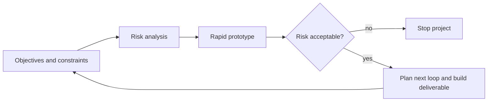

# 01 — Quiz: Software Processes & Lifecycle Models

> Module 01 · Advanced Software Engineering · Term 1 · Farsi: [quiz.fa.md](quiz.fa.md)
> 15 questions: 6 conceptual (40%), 5 read-the-diagram/code/metric-report (≈30%), 4 design/critique (≈30%), plus 3 oral-exam questions. Each question names the note it comes from. Answers are at the end; try first. Lesson: [lesson.en.md](lesson.en.md) · Case study: [case-study.en.md](case-study.en.md).
> Data in questions 7, 10 and 11 is **invented for the exercise** and says so. Schach numbers are cited by chapter and section; the Linux table in question 8 is a real excerpt from v6.18.63.

## A. Conceptual

**1. (note [01](notes/01-software-crisis-and-economics.en.md))** Schach summarizes a Standish Group study of projects completed in 2006. State the three outcome percentages and what each category means. Give one reason not to treat the numbers as a law, and one reason the argument still matters when choosing a process.

**2. (note [01](notes/01-software-crisis-and-economics.en.md))** A manager proposes a coding technique that cuts coding time by 10%, and a colleague proposes a maintenance technique that cuts maintenance cost by 10%. Using Schach's average cost shares, compute the maximum saving of each in percent of total cost and say what the comparison teaches.

**3. (note [02](notes/02-phases-workflows-cost-of-faults.en.md))** (a) What is the difference between a *workflow* and a *phase* in Schach's vocabulary? (b) A tester reports "the export button shows a wrong total". Classify the report, the incorrect line of code, and the programmer's act that caused it as *mistake*, *fault* or *failure*. (c) Why is "design phase" misleading in a team that merges pull requests daily?

**4. (note [03](notes/03-iteration-vs-incrementation.en.md))** Classify each as iteration, incrementation, or both, and explain: (a) release 1.1 adds a new report to 1.0; (b) after the load test the team redesigns the caching layer, keeping all features; (c) the team rewrites the requirements document after the client sees a demo; (d) a feature branch is merged weekly, each merge adding one endpoint with tests.

**5. (note [04](notes/04-plan-driven-models.en.md))** "The waterfall model is obsolete." Give two situations where a plan-driven model is still a reasonable choice, and name two weaknesses that Schach attributes to the waterfall model. What did Royce's 1970 paper itself say about the simple sequential version? (See [case study §8](case-study.en.md).)

**6. (note [06](notes/06-agile-methods.en.md))** For each statement say whether it is a misconception and why: (a) "Agile means no documentation." (b) "Scrum is a life-cycle model." (c) "Timeboxing means the date is fixed and scope is not." (d) "XP has no practices that can be checked." Name the Schach section where timeboxing and stand-up meetings are described.

## B. Read the diagram / code / metric report

**7. (note [08](notes/08-process-improvement-devops-dora.en.md))** The table below is **invented data** for three teams over the last quarter. The column names follow the DORA metrics page (dora.dev, page dated 2026-01-05, fetched 2026-11-23).

| Team | Deployments / week | Change lead time (median) | Change fail rate | Failed-deployment recovery time (median) | Deployment rework rate |
|---|---|---|---|---|---|
| A | 0.5 | 3 weeks | 4% | 6 hours | 2% |
| B | 30 | 2 hours | 22% | 15 minutes | 18% |
| C | 5 | 1 day | 8% | 3 days | 7% |

(a) Which columns belong to the *throughput* group and which to the *instability* group? (b) Describe each team in one sentence. (c) Which team has a recovery problem that its other numbers hide, and what practice would you look at first? (d) Give two reasons the table alone cannot say which team is "best".

**8. (note [07](notes/07-open-source-and-sync-stabilize.en.md))** This is a real excerpt: `linux/Documentation/process/2.Process.rst · "How the development process works" · v6.18.63`, lines 77-86 (all dates are in 2019).

```text
	September 15	5.3 stable release
	September 30	5.4-rc1, merge window closes
	October 6	5.4-rc2
	October 13	5.4-rc3
	October 20	5.4-rc4
	October 27	5.4-rc5
	November 3	5.4-rc6
	November 10	5.4-rc7
	November 17	5.4-rc8
	November 24	5.4 stable release
```

(a) Compute the length of the merge window, of the stabilization period, and of the whole cycle in days. (b) How many `-rc` releases were there, and how many days between them? (c) Which Schach life-cycle model does this resemble, and where does the analogy break? (d) The same file (L89-92) says that the most significant metric used to decide when to close the cycle is the list of regressions. What does this tell you about what "ready" means here?

**9. (note [05](notes/05-spiral-and-unified-process.en.md))** Read the diagram.



(a) Which life-cycle model is this a simplification of? (b) What does the decision node `D` do that a waterfall model has no place for? (c) Name two restrictions Schach gives on the applicability of this model. (d) In a Go repository, what artifact could play the role of box `C`, and what would make it harmful?

**10. (note [02](notes/02-phases-workflows-cost-of-faults.en.md))** Cost per fault by detection phase (**hypothetical numbers for the exercise**, same shape as Schach's Figure 1.6 but not his data):

| Phase of detection | Requirements | Analysis | Design | Implementation | Postdelivery maintenance |
|---|---|---|---|---|---|
| Cost to fix one fault | $20 | $30 | $40 | $150 | $2000 |

A project will contain 50 requirements faults. Option X: no inspections, all found in maintenance. Option Y: requirements inspections that cost $9,000 in total and catch 80% of them in the requirements phase; the rest reach maintenance. Compute the total cost of each option and the saving. Then name one assumption that could make Y worse than the arithmetic says.

**11. (note [08](notes/08-process-improvement-devops-dora.en.md))** A team's script computes change lead time:

```python
from datetime import datetime


def lead_time_hours(commit_ts: str, deploy_ts: str) -> float:
    committed = datetime.fromisoformat(commit_ts)
    deployed = datetime.fromisoformat(deploy_ts)
    return (deployed - committed).seconds / 3600
```

(a) What does the function intend to measure, and which DORA metric is it an input to? (b) Run it mentally with `commit_ts="2026-03-01T10:00:00"` and `deploy_ts="2026-03-03T10:00:00"`. What does it return, and what should it return? (c) Name one more way the result can be wrong or misleading, even after the first bug is fixed.

## C. Design and critique

**12. (notes [04](notes/04-plan-driven-models.en.md), [06](notes/06-agile-methods.en.md), [07](notes/07-open-source-and-sync-stabilize.en.md))** Choose and justify a life-cycle model (or a mix) for each project, naming the one fact about the project that decided it: (a) firmware for an infusion pump under a regulatory approval process; (b) an MVP for a start-up whose only client is the founder, who is available daily; (c) a command-line library used mainly by its own contributors; (d) a 15-year-old billing system that needs one new law implemented before 1 January.

**13. (note [08](notes/08-process-improvement-devops-dora.en.md))** A director announces: "Deployment frequency must reach 50 per week by next quarter. Team bonuses depend on it." Critique this decision in at most five points and propose a replacement scheme that keeps the useful signal.

**14. (note [05](notes/05-spiral-and-unified-process.en.md))** For the Course Registration Platform (Go API, PostgreSQL, message broker, Python analytics), list the three highest technical or product risks you would attack in an *elaboration*-style first iteration. For each give a cheapest-possible experiment, the evidence that would make you stop or change course, and where the result is recorded in the repository.

**15. (note [07](notes/07-open-source-and-sync-stabilize.en.md), lab [07](labs/07-contributing-guide/README.md))** Using the Linux excerpts in the [case study](case-study.en.md) (one logical change per patch; the `Reviewed-by` statement; style checked before posting), write a five-item pull-request checklist for a team of four. Then pick the item you would drop first if reviews became a bottleneck, and say what you would measure to decide that.

## Oral-exam questions

**O1.** "Waterfall is dead." Defend or attack that statement using Royce, Schach's comparison of life-cycle models (§2.10), and one example from your own work. What would be your evidence?

**O2.** Schach (2011) says open-source projects generally have no specification or design. Compare that statement with what you can read in Linux `Documentation/process/` today. Which parts of Schach's open-source model still hold?

**O3.** Are CMMI-style maturity levels and DORA metrics complementary or in conflict? Include Brooks's law in your answer: if a project is late, what does each approach tell management to do?

---

## Answers

**1.** Successfully completed 35%; cancelled before completion or never implemented 19%; the remaining 46% completed and installed but over budget, late, or with fewer features and less functionality than specified (Schach's wording, paraphrased). Source: `Schach 8e, ch. 1 §1.1`, Figure 1.1, citing a Standish Group study of 2006 projects. Not a law: it is one survey with a disputed methodology `OPINION / CONTESTED`, and the definitions of success are the surveyor's. It still matters because even if the exact numbers move, a substantial share of projects miss schedule, budget or scope, so the order of work cannot be left to habit.

**2.** Coding plus unit testing is on average 34% of the 25% of total cost that is not maintenance, i.e. 8.5% of total cost (`ch. 1 §1.3.2`, p. 12). A 10% saving there is 0.1 x 8.5% = **0.85%** of total cost at most. Maintenance is about 75% of the total in the newer data (the book says 70-80% or more); 10% of that is **7.5%** of total cost. Lesson: evaluate a technique by the share of total cost it can touch. A big saving on a small share is small; a modest saving on the dominant share is large, and the maintenance share is why design for change and early fault removal matter.

**3.** (a) A workflow (requirements, analysis, design, implementation, test) is an activity that continues across the project; a phase is a period with a goal and a milestone. Several workflows are active in one phase. (b) The tester's report of wrong output is a **failure** (observable incorrect behaviour); the wrong line in the code is a **fault** (defect); the programmer's act (for example, misreading the rounding rule) is a **mistake**. (The incorrect internal value while running would be an *error*.) (c) Because design decisions are made, revised and recorded in every pull request and ADR, not in one period of time; Schach separates workflows from phases for this reason (`ch. 2 §2.5`, `ch. 3`).

**4.** (a) Incrementation: new functionality added to the previous build. (b) Iteration: the same artifact (the design) is improved; functionality does not change. (c) Iteration of the requirements workflow. (d) Both: each merge is an increment; each merged branch also revises existing tests and code, so there is iteration inside every increment. Schach's point (§2.5) is that real projects do both, in every workflow.

**5.** Reasonable uses of a plan-driven model: stable, well-understood requirements; a contract with fixed scope; safety-critical work where documents and verification evidence are deliverables; a regulatory gate. Weaknesses attributed by Schach: the delivered product may not be what the client needs, and it assumes software is developed in discrete phases, whereas real development is iterative and incremental (`§2.9.2`, `§2.10`, `§2.9.7`). Royce's paper (opened as a reprint, [case study §8](case-study.en.md)) shows the simple sequential figure, calls its implementation "risky" and one that "invites failure", because testing at the end is the first time timing, storage and I/O are experienced, and recommends five additions including doing the job twice and involving the customer. So "waterfall is obsolete" attacks the first figure, which the source itself did not endorse.

**6.** (a) Misconception: the Manifesto values working software over comprehensive documentation, not instead of it; XP in Schach has stories, retained test cases and an explicit client role. (b) Misconception: Scrum is a management framework for timeboxed iterations; it does not say how to design or test (Scrum is outside Schach; modern practice). (c) Misconception, because it is inverted: timeboxing fixes the *time* and lets the *scope* flex (Schach describes setting aside a specific amount of time for a task and doing the best job possible within it). (d) Misconception: XP's practices (test-first, pair programming, continuous integration, no overtime for two successive weeks, a client representative with the team) are explicit and observable. Timeboxing and stand-up meetings are in `Schach 8e, ch. 2 §2.9.5`, pp. 60-61.

**7.** (a) Throughput: deployments per week, change lead time, failed-deployment recovery time. Instability: change fail rate, deployment rework rate (dora.dev page, 2026-01-05). VERSION-DEPENDENT: earlier DORA materials used four "key metrics" (`UNVERIFIED` here, not opened). (b) A: rare, slow, careful, with low failure and fast recovery. B: very frequent, very fast, with a high failure and rework rate but quick recovery (small changes, fast rollback). C: weekly cadence, moderate failure, but recovery takes days. (c) Team C: failure is rare enough, but a 3-day recovery shows missing rollback or no incident practice; look at rollback automation, on-call and whether a deployment can be reverted independently of the code change. (d) Context is missing: the cost of a failure (an infusion pump vs an internal dashboard), what counts as a deployment or a failure, sample size (A's 4% may be one failure in 25 deployments), and the quarter's work mix. Metrics are indicators, not targets.

**8.** (a) Merge window: Sep 15 to Sep 30 = **15 days** (about two weeks). Stabilization: Sep 30 to Nov 24 = **55 days** (about eight weeks). Whole cycle: **70 days** (ten weeks). The merge window is about 21% of the cycle. (b) `-rc1` to `-rc8` is eight `-rc` releases (rc1 is the window's end); consecutive releases are 7 days apart, except `-rc1` to `-rc2` (6 days). The file says a normal cycle gets up to somewhere between `-rc6` and `-rc9` (L68-70). (c) It resembles synchronize-and-stabilize (§2.9.6): a period of integration followed by stabilization that freezes new features. The analogy breaks on: scale and organization (thousands of contributors vs Microsoft's in-company teams), the daily synchronization (Linux's integration happens in subsystem trees and linux-next, not one daily build), and the fact that the Linux end date is decided by readiness, not fixed. The analogy is mine, not Schach's. (d) "Ready" is defined by absence of known regressions (things that worked before and now do not), not by a feature checklist: the release criterion protects existing users.

**9.** (a) The spiral model (Boehm 1988, described in `Schach 8e, ch. 2 §2.9.7`). (b) The decision node: at each loop, after risk analysis and a prototype, the project can be stopped. Waterfall has no such formal point; its feedback arrows only go back to the previous phase. (c) Schach: intended for internal, large-scale development (a contract makes stopping a legal matter; the risk analysis costs must be small relative to the project), and it depends on the team's skill in risk analysis (`§2.9.7`, p. 66). (d) A clearly labelled `spike/` branch or a throw-away prototype directory plus an ADR that records the result. It is harmful when it is merged and silently becomes the product, or when its result is not written down (a common pitfall; I did not check Schach's wording on it).

**10.** Option X: 50 x $2000 = **$100,000**. Option Y: 40 faults found at $20 = $800; 10 reach maintenance = $20,000; inspections = $9,000; total **$29,800**. Saving **$70,200** (70.2%). Assumptions that could make Y worse: the 80% detection rate is optimistic (inspection effectiveness varies, Schach reports JPL inspections found about 1.9 faults per page of specification, so detection depends on reviewer skill and document quality); the maintenance cost per fault is much lower in your context (continuous deployment with cheap rollback); or the inspection delays the schedule enough to cost more than the saving. Note the check: $800 + $20,000 + $9,000 = $29,800; $100,000 - $29,800 = $70,200.

**11.** (a) The time between committing a change and having it in production; it is an input to **change lead time** (the DORA definition is from committing to version control until it reaches production). (b) `timedelta.seconds` returns only the seconds component of the time of day (0 to 86399), ignoring whole days, so the result is `0.0` hours; the correct answer is **48.0** (`total_seconds() / 3600`). (c) Any of: mixing timezone-aware and naive timestamps raises `TypeError`; using the *last* commit of a branch instead of the first understates lead time (the work waited before the final commit); a deployment that was later rolled back still counts as a success; averaging instead of using the median lets a few outliers dominate; clock skew between systems.

**12.** Sample answers (justify the deciding fact). (a) Plan-driven with documented verification (V-model style), iterating inside the design phases: a regulatory gate and safety requirements make documents deliverables. (b) Agile (XP or Kanban): the client is on hand daily, so frequent feedback is the control mechanism; keep a minimal written backlog. (c) Open-source model: the users are the co-maintainers (Schach's condition for the model to work), so the core group can review what peripheral users submit. (d) Mix: a fixed date and an immovable scope (a law) call for timeboxed planning with the scope fixed up front, but a legacy codebase calls for iteration with regression tests first; Kanban with a hard milestone is acceptable. Any defensible mix is fine, as long as the deciding fact is named (Schach §2.10: choose by organization, management, employees and the process).

**13.** Points: (1) deployment frequency is an *indicator*; making it a target invites gaming (split deployments, empty deploys). (2) A fixed jump from the current value ignores the constraint (test time, approvals, architecture). (3) Bonuses tied to one metric shift effort away from stability: check change fail rate and recovery time. (4) It ignores value: ten deploys of nothing are not progress. (5) It punishes teams that are limited by regulation or hardware. Replacement: use the metrics as a diagnostic with a trend (all five DORA metrics together), set team-owned improvement goals (for example, "reduce lead time by removing the manual approval step"), and review them with the teams. The Goodhart-style argument is common in the literature but I have not opened a source for it `OPINION / CONTESTED`.

**14.** One acceptable answer. Risk 1: *concurrent enrolment overselling a seat.* Experiment: a Go test with N goroutines enrolling in a course with one seat, run against PostgreSQL; stop and change the design if two succeed. Recorded in an ADR and the test file (this is the Module 03 TLA+ model's subject). Risk 2: *event pipeline delivers duplicates to analytics.* Experiment: publish the same event twice through the broker and check whether the analytics service double counts; recorded in an ADR on idempotency. Risk 3: *students cannot complete registration in the offered flow (product risk).* Experiment: a clickable CLI/web prototype shown to two users; stop if they need help in the first step; recorded in the backlog with the decision. Marking criteria: risks are specific, experiments are cheap and time-boxed, stop criteria are explicit, results live in the repo (ADR, test, issue).

**15.** One acceptable answer. (1) One logical change per PR, no unrelated reformatting (from `submitting-patches.rst`, "Separate your changes"). (2) Style and lint pass before review (the Linux text says that failing to do so "wastes the reviewers time"); a CI job enforces it. (3) The reviewer writes what they reviewed and whether concerns were resolved (modelled on the `Reviewed-by` statement L562-575). (4) Tests for the changed behaviour are present or the PR explains why not. (5) The description says why, in the imperative mood for the summary line. Drop first: item (3) in a 4-person team where everyone sees every PR, because written statements are the highest ceremony cost; measure PR review time (median open-to-merge) and post-merge defects (change fail rate): if review time falls and defects do not rise, the item was not paying for itself. Any measurable decision rule is accepted.

**O1 (points to cover).** Attack: a linear plan assumes stable requirements and delays testing; Royce's own paper calls the one-pass implementation risky; Schach says the waterfall assumes discrete phases while real development is iterative and incremental (§2.9.7, §2.10). Defend: it is a known quantity (Schach, §2.10), documents and sign-off are the product in regulated and contract work, and each iteration of an iterative model can be viewed as a small waterfall (Schach, §2.7). Evidence you would want: defect and rework data by phase, requirements volatility, and cost of a late fault in this domain. Be honest that most comparative studies are observational `OPINION / CONTESTED`.

**O2 (points to cover).** Schach (§2.9.4): informal start, then postdelivery maintenance by volunteers, generally no specification or design, works because the people are skilled and because users are co-maintainers; "release early, release often". Today's Linux tree contains `Documentation/process/` with a merge window, `-rc` releases, linux-next, tagged sign-off and review statements, coding style, and a deprecated-interface list (case study §§2-5): process written down and enforced socially. What still holds: users as co-maintainers; the core group decides what goes in; frequent releases; maintenance-dominated life. What does not: "no specification or design" as a general description (design exists in documents, mailing-list discussion and the API conventions; I have not verified how formal) and "unpaid volunteers" as the main workforce `UNVERIFIED`.

**O3 (points to cover).** CMMI-style levels (Schach §3.13) judge organizational process capability: measurement, defined and managed processes, improvement. DORA measures delivery outcomes (lead time, deployment frequency, recovery, change fail rate, rework rate) and relates them to practices. Complementary: the first asks whether you have a defined, measured process, the second tells you what the process produces. Conflict: heavy documentation to reach a level can lengthen lead time; metrics without defined practice can be gamed. Brooks's law (Schach §4.1): adding people to a late project makes it later, because of training and communication costs. A maturity-model view says measure and fix the process first; a DORA view says shrink batch size and cycle time (cut scope or release smaller increments) before adding people. Neither says "add people".
