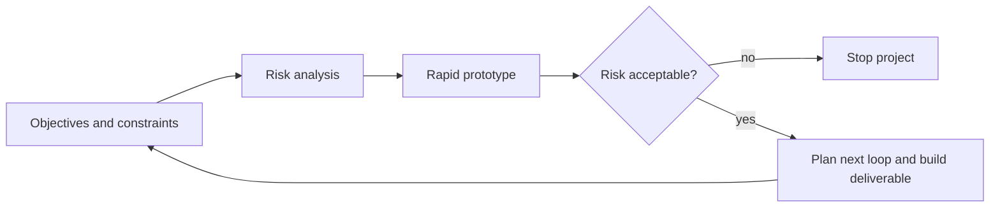

<div dir="rtl">

# ۰۱ — آزمونک: فرایندهای نرم‌افزار و مدل‌های چرخهٔ حیات

> ماژول ۰۱ · مهندسی نرم‌افزار پیشرفته · ترم ۱ · نسخهٔ انگلیسی: [quiz.en.md](quiz.en.md)
> ۱۵ پرسش: ۶ مفهومی (۴۰٪)، ۵ خواندن نمودار/کد/گزارش متریک (حدود ۳۰٪)، ۴ طراحی و نقد (حدود ۳۰٪)، به‌اضافهٔ ۳ پرسش امتحان شفاهی. هر پرسش یادداشت مربوطه را نام می‌برد. پاسخ‌ها در انتهای فایل‌اند؛ اول خودتان تلاش کنید. درس: [lesson.fa.md](lesson.fa.md) · Case study: [case-study.fa.md](case-study.fa.md).
> داده‌های پرسش‌های 7، 10 و 11 **برای تمرین ساخته شده‌اند** و همین را می‌گویند. عددهای Schach با فصل و بخش ارجاع شده‌اند؛ جدول Linux در پرسش 8 یک excerpt واقعی از v6.18.63 است.

## الف. مفهومی

**۱. (یادداشت [01](notes/01-software-crisis-and-economics.fa.md))** Schach مطالعه‌ای از Standish Group را روی پروژه‌های تمام‌شده در 2006 خلاصه می‌کند. سه درصد نتیجه و معنای هر دسته را بگویید. یک دلیل بیاورید که چرا این عددها را نباید قانون دانست، و یک دلیل که چرا استدلال هنگام انتخاب فرایند هنوز مهم است.

**۲. (یادداشت [01](notes/01-software-crisis-and-economics.fa.md))** مدیری تکنیک coding پیشنهاد می‌دهد که زمان coding را 10٪ کم می‌کند و همکارش تکنیک maintenance که هزینهٔ maintenance را 10٪ کم می‌کند. با سهم‌های هزینهٔ میانگین Schach حداکثر صرفه‌جویی هر کدام را به درصد کل هزینه حساب کنید و بگویید این مقایسه چه می‌آموزد.

**۳. (یادداشت [02](notes/02-phases-workflows-cost-of-faults.fa.md))** (الف) در واژگان Schach تفاوت *workflow* و *phase* چیست؟ (ب) یک tester گزارش می‌دهد «دکمهٔ export مجموع غلط نشان می‌دهد». گزارش، خط نادرست کد و عمل برنامه‌نویس که باعثش شده را به‌عنوان *mistake*، *fault* یا *failure* دسته‌بندی کنید. (ج) چرا «design phase» در تیمی که روزانه pull request merge می‌کند گمراه‌کننده است؟

**۴. (یادداشت [03](notes/03-iteration-vs-incrementation.fa.md))** هر مورد را iteration، incrementation یا هر دو دسته‌بندی کنید و توضیح دهید: (الف) release 1.1 یک گزارش جدید به 1.0 اضافه می‌کند؛ (ب) بعد از load test تیم لایهٔ caching را بازطراحی می‌کند و همهٔ قابلیت‌ها را نگه می‌دارد؛ (ج) تیم بعد از دیدن demo توسط client سند requirements را بازنویسی می‌کند؛ (د) یک feature branch هفتگی merge می‌شود و هر merge یک endpoint همراه با تست اضافه می‌کند.

**۵. (یادداشت [04](notes/04-plan-driven-models.fa.md))** «مدل waterfall منسوخ است.» دو وضعیت بیاورید که مدل plan-driven هنوز انتخاب معقولی است و دو ضعفی که Schach به waterfall نسبت می‌دهد را نام ببرید. مقالهٔ Royce در 1970 خودش دربارهٔ نسخهٔ ساده و ترتیبی چه گفت؟ ([case study §8](case-study.fa.md) را ببینید.)

**۶. (یادداشت [06](notes/06-agile-methods.fa.md))** برای هر گزاره بگویید تصور غلط است یا نه و چرا: (الف) «agile یعنی بدون مستندات.» (ب) «Scrum یک life-cycle model است.» (ج) «Timeboxing یعنی تاریخ ثابت است و scope نه.» (د) «XP رویه‌ای ندارد که بشود بررسی‌اش کرد.» بخشی از Schach را نام ببرید که timeboxing و stand-up meeting در آن توصیف شده‌اند.

## ب. خواندن نمودار / کد / گزارش متریک

**۷. (یادداشت [08](notes/08-process-improvement-devops-dora.fa.md))** جدول زیر **داده‌های ساختگی** برای سه تیم در سه ماه اخیر است. نام ستون‌ها از صفحهٔ DORA metrics پیروی می‌کند (dora.dev، تاریخ صفحه 2026-01-05، دریافت 2026-11-23).

</div>

| Team | Deployments / week | Change lead time (median) | Change fail rate | Failed-deployment recovery time (median) | Deployment rework rate |
|---|---|---|---|---|---|
| A | 0.5 | 3 weeks | 4% | 6 hours | 2% |
| B | 30 | 2 hours | 22% | 15 minutes | 18% |
| C | 5 | 1 day | 8% | 3 days | 7% |

<div dir="rtl">

(الف) کدام ستون‌ها به گروه *throughput* و کدام به گروه *instability* تعلق دارند؟ (ب) هر تیم را در یک جمله توصیف کنید. (ج) کدام تیم مشکل بازیابی دارد که بقیهٔ عددهایش پنهانش می‌کنند، و اول به کدام رویه نگاه می‌کنید؟ (د) دو دلیل بیاورید که چرا جدول به‌تنهایی نمی‌تواند بگوید کدام تیم «بهترین» است.

**۸. (یادداشت [07](notes/07-open-source-and-sync-stabilize.fa.md))** این یک excerpt واقعی است: `linux/Documentation/process/2.Process.rst · "How the development process works" · v6.18.63`، خطوط 77-86 (همهٔ تاریخ‌ها در 2019 هستند).

</div>

```text
	September 15	5.3 stable release
	September 30	5.4-rc1, merge window closes
	October 6	5.4-rc2
	October 13	5.4-rc3
	October 20	5.4-rc4
	October 27	5.4-rc5
	November 3	5.4-rc6
	November 10	5.4-rc7
	November 17	5.4-rc8
	November 24	5.4 stable release
```

<div dir="rtl">

(الف) طول merge window، دورهٔ stabilization و کل چرخه را به روز حساب کنید. (ب) چند release از نوع `-rc` وجود داشت و فاصلهٔ بینشان چند روز بود؟ (ج) این به کدام مدل چرخهٔ حیات Schach شبیه است و قیاس کجا می‌شکند؟ (د) همین فایل (L89-92) می‌گوید مهم‌ترین متریک برای تصمیم دربارهٔ بستن چرخه فهرست regressionهاست. این دربارهٔ معنای «آماده» اینجا چه می‌گوید؟

**۹. (یادداشت [05](notes/05-spiral-and-unified-process.fa.md))** نمودار را بخوانید.

</div>



<div dir="rtl">

(الف) این ساده‌شدهٔ کدام مدل چرخهٔ حیات است؟ (ب) گرهٔ تصمیم `D` چه کاری می‌کند که waterfall جایی برایش ندارد؟ (ج) دو محدودیت که Schach برای کاربردپذیری این مدل می‌دهد را نام ببرید. (د) در یک مخزن Go چه artifactی می‌تواند نقش جعبهٔ `C` را بازی کند و چه چیزی آن را مضر می‌کند؟

**۱۰. (یادداشت [02](notes/02-phases-workflows-cost-of-faults.fa.md))** هزینهٔ هر fault بر حسب phase کشف (**اعداد فرضی برای تمرین**، هم‌شکل Figure 1.6 Schach اما نه دادهٔ او):

</div>

| Phase of detection | Requirements | Analysis | Design | Implementation | Postdelivery maintenance |
|---|---|---|---|---|---|
| Cost to fix one fault | $20 | $30 | $40 | $150 | $2000 |

<div dir="rtl">

یک پروژه 50 fault از نوع requirements خواهد داشت. گزینهٔ X: بدون inspection، همه در maintenance پیدا می‌شوند. گزینهٔ Y: inspectionهای requirements که در مجموع $9,000 خرج دارند و 80٪ آن‌ها را در phase مربوط به requirements می‌گیرند؛ بقیه به maintenance می‌رسند. هزینهٔ کل هر گزینه و صرفه‌جویی را حساب کنید. بعد یک فرض را نام ببرید که می‌تواند Y را بدتر از آنچه حساب نشان می‌دهد بکند.

**۱۱. (یادداشت [08](notes/08-process-improvement-devops-dora.fa.md))** اسکریپت یک تیم، change lead time را حساب می‌کند:

</div>

```python
from datetime import datetime


def lead_time_hours(commit_ts: str, deploy_ts: str) -> float:
    committed = datetime.fromisoformat(commit_ts)
    deployed = datetime.fromisoformat(deploy_ts)
    return (deployed - committed).seconds / 3600
```

<div dir="rtl">

(الف) تابع قصد دارد چه چیزی را اندازه بگیرد و ورودی کدام متریک DORA است؟ (ب) آن را ذهنی با `commit_ts="2026-03-01T10:00:00"` و `deploy_ts="2026-03-03T10:00:00"` اجرا کنید. چه برمی‌گرداند و باید چه برگرداند؟ (ج) حتی بعد از رفع باگ اول، یک راه دیگر را نام ببرید که نتیجه می‌تواند غلط یا گمراه‌کننده باشد.

## ج. طراحی و نقد

**۱۲. (یادداشت‌های [04](notes/04-plan-driven-models.fa.md)، [06](notes/06-agile-methods.fa.md)، [07](notes/07-open-source-and-sync-stabilize.fa.md))** برای هر پروژه یک مدل چرخهٔ حیات (یا ترکیب) انتخاب و توجیه کنید و بگویید کدام یک واقعیت دربارهٔ پروژه تصمیم را گرفت: (الف) firmware برای پمپ تزریق با فرایند تأیید نظارتی؛ (ب) یک MVP برای استارتاپی که تنها client آن بنیان‌گذار است و هر روز در دسترس است؛ (ج) یک کتابخانهٔ خط فرمان که بیشتر خود مشارکت‌کنندگانش استفاده‌اش می‌کنند؛ (د) یک سیستم صورتحساب 15 ساله که باید قبل از اول ژانویه یک قانون جدید در آن پیاده شود.

**۱۳. (یادداشت [08](notes/08-process-improvement-devops-dora.fa.md))** مدیری اعلام می‌کند: «deployment frequency باید تا فصل بعد به 50 در هفته برسد. پاداش تیم‌ها به آن وابسته است.» این تصمیم را در حداکثر پنج نکته نقد کنید و طرح جایگزینی پیشنهاد دهید که سیگنال مفید را نگه می‌دارد.

**۱۴. (یادداشت [05](notes/05-spiral-and-unified-process.fa.md))** برای Course Registration Platform (‏API به Go، ‏PostgreSQL، message broker، تحلیل‌گر Python) سه ریسک فنی یا محصولیِ بالا را فهرست کنید که در iteration اول به سبک *elaboration* به آن‌ها حمله می‌کنید. برای هر کدام ارزان‌ترین آزمایش ممکن، شاهدی که شما را به توقف یا تغییر مسیر وامی‌دارد و جایی در مخزن که نتیجه ثبت می‌شود را بدهید.

**۱۵. (یادداشت [07](notes/07-open-source-and-sync-stabilize.fa.md)، آزمایش [07](labs/07-contributing-guide/README.md))** با excerptهای Linux در [case study](case-study.fa.md) (یک تغییر منطقی در هر patch؛ بیانیهٔ `Reviewed-by`؛ بررسی سبک قبل از ارسال) یک checklist پنج‌موردی برای pull request تیمی چهار نفره بنویسید. بعد موردی را انتخاب کنید که اگر reviewها گلوگاه شدند اول حذفش می‌کنید و بگویید برای تصمیم‌گیری چه چیزی را اندازه می‌گیرید.

## پرسش‌های امتحان شفاهی

**O1.** «Waterfall مرده است.» با Royce، مقایسهٔ Schach از مدل‌های چرخهٔ حیات (§2.10) و یک مثال از کار خودتان از یا علیه این گزاره دفاع کنید. شاهدتان چه خواهد بود؟

**O2.** Schach (2011) می‌گوید پروژه‌های open-source عموماً specification و design ندارند. این گزاره را با آنچه امروز در Linux `Documentation/process/` می‌توان خواند مقایسه کنید. کدام بخش‌های مدل open-source Schach هنوز برقرارند؟

**O3.** آیا سطح‌های بلوغ به سبک CMMI و متریک‌های DORA مکمل‌اند یا در تضاد؟ Brooks's law را هم وارد پاسخ کنید: اگر پروژه‌ای عقب است، هر رویکرد به مدیریت چه می‌گوید؟

---

## پاسخ‌ها

**۱.** موفق (successfully completed) 35٪؛ لغوشده پیش از تکمیل یا هرگز پیاده‌نشده 19٪؛ 46٪ باقیمانده تمام و نصب شدند اما بیش از بودجه، دیر، یا با قابلیت‌های کمتر از مشخصات (بازگویی عبارت Schach). منبع: `Schach 8e, ch. 1 §1.1`، Figure 1.1، به نقل از مطالعهٔ Standish Group روی پروژه‌های 2006. قانون نیست: یک نظرسنجی با روش‌شناسی محل بحث است `OPINION / CONTESTED` و تعریف «موفقیت» تعریف نظرسنج است. با این حال مهم است چون حتی اگر عددهای دقیق جابه‌جا شوند، سهم قابل توجهی از پروژه‌ها از زمان، بودجه یا scope جا می‌مانند، پس ترتیب کار را نمی‌شود به عادت سپرد.

**۲.** coding به‌اضافهٔ unit testing به‌طور میانگین 34٪ از آن 25٪ هزینهٔ کل است که maintenance نیست، یعنی 8.5٪ کل هزینه (`ch. 1 §1.3.2`، ص 12). صرفه‌جویی 10٪ در آن حداکثر 0.1 × 8.5٪ = **0.85٪** کل هزینه است. maintenance در دادهٔ جدیدتر حدود 75٪ کل است (کتاب 70 تا 80٪ یا بیشتر می‌گوید)؛ 10٪ آن **7.5٪** کل هزینه است. درس: یک تکنیک را با سهمی از کل هزینه که می‌تواند به آن دست بزند بسنجید. صرفه‌جویی بزرگ روی سهم کوچک کوچک است؛ صرفه‌جویی متوسط روی سهم غالب بزرگ است، و سهم maintenance دلیل اهمیت طراحی برای تغییر و رفع زودهنگام faultهاست.

**۳.** (الف) workflow (‏requirements، analysis، design، implementation، test) فعالیتی است که در تمام پروژه ادامه دارد؛ phase دوره‌ای با هدف و milestone است. چند workflow در یک phase فعال‌اند. (ب) گزارش خروجی غلط یک **failure** است (رفتار نادرست قابل مشاهده)؛ خط غلط در کد یک **fault** است (defect)؛ عمل برنامه‌نویس (مثلاً بد فهمیدن قاعدهٔ گرد کردن) یک **mistake**. (مقدار نادرست داخلی هنگام اجرا یک *error* می‌شود.) (ج) چون تصمیم‌های طراحی در هر pull request و ADR گرفته، بازنگری و ثبت می‌شوند، نه در یک بازهٔ زمانی؛ Schach به همین دلیل workflow را از phase جدا می‌کند (`ch. 2 §2.5`، `ch. 3`).

**۴.** (الف) Incrementation: قابلیت جدید به build قبلی اضافه شده. (ب) Iteration: همان artifact (طراحی) بهتر می‌شود؛ قابلیت تغییر نمی‌کند. (ج) Iteration در workflow مربوط به requirements. (د) هر دو: هر merge یک increment است؛ هر branch merge‌شده تست‌ها و کد موجود را هم بازنگری می‌کند، پس درون هر increment iteration هست. نکتهٔ Schach (§2.5) این است که پروژه‌های واقعی در هر workflow هر دو را انجام می‌دهند.

**۵.** کاربردهای معقول مدل plan-driven: requirements پایدار و خوب فهمیده‌شده؛ قرارداد با scope ثابت؛ کار safety-critical که سند و شواهد verification خودِ تحویلی هستند؛ گیت نظارتی. ضعف‌هایی که Schach نسبت می‌دهد: محصول تحویل‌شده ممکن است همان چیزی نباشد که client لازم دارد، و فرض می‌کند نرم‌افزار در phaseهای گسسته ساخته می‌شود، در حالی که توسعهٔ واقعی iterative و incremental است (`§2.9.2`، `§2.10`، `§2.9.7`). مقالهٔ Royce (به‌صورت reprint باز شد، [case study §8](case-study.fa.md)) شکل ساده و ترتیبی را نشان می‌دهد، پیاده‌سازی آن را «risky» و «invites failure» می‌نامد، چون تست در انتها اولین باری است که timing، storage و I/O تجربه می‌شوند، و پنج افزودنی توصیه می‌کند از جمله دو بار انجام دادن کار و درگیر کردن مشتری. پس «waterfall منسوخ است» شکل اول را هدف می‌گیرد که خود منبع آن را تأیید نکرده بود.

**۶.** (الف) تصور غلط: Manifesto نرم‌افزار کارا را بر مستندات جامع مقدم می‌دارد، نه به‌جای آن؛ XP در Schach story، تست‌های نگه‌داشته‌شده و نقش صریح client دارد. (ب) تصور غلط: Scrum چارچوب مدیریتی برای iterationهای timebox‌شده است؛ نمی‌گوید چطور طراحی یا تست کنید (Scrum بیرون از Schach است؛ رویهٔ مدرن). (ج) تصور غلط، چون وارونه است: timeboxing *زمان* را ثابت می‌کند و می‌گذارد *scope* کم و زیاد شود (Schach کنار گذاشتن مقدار مشخصی زمان برای یک کار و انجام بهترین کار ممکن در آن را توصیف می‌کند). (د) تصور غلط: رویه‌های XP (test-first، pair programming، continuous integration، بدون اضافه‌کاری دو هفتهٔ پیاپی، نمایندهٔ client همراه تیم) صریح و قابل مشاهده‌اند. timeboxing و stand-up meeting در `Schach 8e, ch. 2 §2.9.5`، ص 60-61 هستند.

**۷.** (الف) Throughput: deployments per week، change lead time، failed-deployment recovery time. Instability: change fail rate، deployment rework rate (صفحهٔ dora.dev، 2026-01-05). VERSION-DEPENDENT: مواد قدیمی‌تر DORA چهار «key metric» داشتند (`UNVERIFIED` اینجا، باز نشد). (ب) A: نادر، کند و محتاط، با شکست کم و بازیابی سریع. B: بسیار پرتکرار و بسیار سریع، با نرخ شکست و rework بالا اما بازیابی فوری (تغییرهای کوچک، rollback سریع). C: ریتم هفتگی، شکست متوسط، اما بازیابی روزها طول می‌کشد. (ج) تیم C: شکست به‌قدر کافی نادر است، اما بازیابی 3 روزه یعنی rollback یا رویهٔ incident وجود ندارد؛ اول به خودکارسازی rollback، on-call و اینکه آیا می‌شود یک deployment را مستقل از تغییر کد برگرداند نگاه کنید. (د) بافت غایب است: هزینهٔ یک شکست (پمپ تزریق در برابر یک dashboard داخلی)، اینکه چه چیزی deployment یا شکست حساب می‌شود، اندازهٔ نمونه (4٪ در A ممکن است یک شکست از 25 deployment باشد) و ترکیب کار فصل. متریک‌ها شاخص‌اند، نه هدف.

**۸.** (الف) Merge window: از Sep 15 تا Sep 30 = **15 روز** (حدود دو هفته). Stabilization: از Sep 30 تا Nov 24 = **55 روز** (حدود هشت هفته). کل چرخه: **70 روز** (ده هفته). merge window حدود 21٪ چرخه است. (ب) `-rc1` تا `-rc8` هشت release از نوع `-rc` است (rc1 پایان پنجره است)؛ releaseهای متوالی 7 روز با هم فاصله دارند، جز `-rc1` تا `-rc2` (6 روز). فایل می‌گوید یک چرخهٔ معمولی تا جایی بین `-rc6` و `-rc9` می‌رود (L68-70). (ج) شبیه synchronize-and-stabilize (§2.9.6) است: دورهٔ یکپارچه‌سازی و بعد stabilization که قابلیت‌های جدید را freeze می‌کند. قیاس در این‌ها می‌شکند: مقیاس و سازمان (هزاران مشارکت‌کننده در برابر تیم‌های درون شرکت Microsoft)، synchronization روزانه (یکپارچه‌سازی Linux در درخت‌های زیرسیستم و linux-next رخ می‌دهد نه یک build روزانه)، و اینکه تاریخ پایان در Linux را آمادگی تعیین می‌کند، نه تاریخی ثابت. قیاس از من است نه از Schach. (د) «آماده» با نبودِ regressionهای شناخته‌شده (چیزهایی که پیش‌تر کار می‌کردند و حالا نمی‌کنند) تعریف می‌شود، نه با فهرست قابلیت‌ها: معیار release از کاربران موجود محافظت می‌کند.

**۹.** (الف) مدل spiral (‏Boehm 1988، شرح‌شده در `Schach 8e, ch. 2 §2.9.7`). (ب) گرهٔ تصمیم: در هر حلقه، بعد از risk analysis و prototype، پروژه می‌تواند متوقف شود. waterfall چنین نقطهٔ رسمی‌ای ندارد؛ پیکان‌های بازخوردش فقط به phase قبلی برمی‌گردند. (ج) Schach: برای توسعهٔ داخلی و بزرگ‌مقیاس در نظر گرفته شده (قرارداد توقف را مسئله‌ای حقوقی می‌کند؛ هزینهٔ risk analysis باید نسبت به پروژه کوچک باشد)، و به مهارت تیم در risk analysis بستگی دارد (`§2.9.7`، ص 66). (د) یک branch با برچسب روشن `spike/` یا پوشهٔ prototype دورریختنی به‌اضافهٔ ADRای که نتیجه را ثبت می‌کند. وقتی مضر است که merge شود و بی‌سروصدا محصول شود، یا نتیجه‌اش نوشته نشود (یک تله رایج؛ عبارت Schach را دربارهٔ آن بررسی نکردم).

**۱۰.** گزینهٔ X: 50 × $2000 = **$100,000**. گزینهٔ Y: 40 fault که با $20 پیدا شوند = $800؛ 10 fault که به maintenance می‌رسند = $20,000؛ inspectionها = $9,000؛ جمع **$29,800**. صرفه‌جویی **$70,200** (70.2٪). فرض‌هایی که می‌توانند Y را بدتر کنند: نرخ کشف 80٪ خوش‌بینانه است (اثربخشی inspection متغیر است؛ Schach گزارش می‌کند inspectionهای JPL حدود 1.9 fault در هر صفحهٔ specification پیدا کردند، پس کشف به مهارت reviewer و کیفیت سند بستگی دارد)؛ هزینهٔ هر fault در maintenance در بافت شما بسیار کمتر است (continuous deployment با rollback ارزان)؛ یا inspection زمان‌بندی را آن‌قدر عقب می‌اندازد که از صرفه‌جویی گران‌تر تمام شود. بررسی: $800 + $20,000 + $9,000 = $29,800؛ $100,000 − $29,800 = $70,200.

**۱۱.** (الف) زمان بین commit یک تغییر و رسیدنش به production؛ ورودی **change lead time** است (تعریف DORA از commit در version control تا رسیدن به production است). (ب) `timedelta.seconds` فقط مؤلفهٔ ثانیهٔ ساعت روز (0 تا 86399) را برمی‌گرداند و روزهای کامل را نادیده می‌گیرد، پس نتیجه `0.0` ساعت است؛ پاسخ درست **48.0** است (`total_seconds() / 3600`). (ج) هر کدام: مخلوط کردن timestampهای timezone-aware و naive باعث `TypeError` می‌شود؛ استفاده از *آخرین* commit یک branch به‌جای اولین lead time را کمتر نشان می‌دهد (کار پیش از commit آخر منتظر مانده)؛ deploymentای که بعداً rollback شده هنوز موفق حساب می‌شود؛ میانگین به‌جای median باعث می‌شود چند outlier غالب شوند؛ clock skew بین سیستم‌ها.

**۱۲.** پاسخ‌های نمونه (واقعیت تعیین‌کننده را توجیه کنید). (الف) plan-driven با verification مستند (سبک V-model) و iteration درون phaseهای design: گیت نظارتی و requirementهای ایمنی سندها را تحویلی می‌کنند. (ب) Agile (‏XP یا Kanban): client هر روز در دسترس است، پس بازخورد مکرر سازوکار کنترل است؛ یک backlog مکتوبِ حداقلی نگه دارید. (ج) مدل open-source: کاربران co-maintainer هستند (شرط Schach برای کار کردن مدل)، پس core group می‌تواند آنچه کاربران peripheral می‌فرستند را review کند. (د) ترکیب: تاریخ ثابت و scope غیرقابل تغییر (یک قانون) برنامه‌ریزی timebox‌شده با scope ثابت از اول می‌طلبد، اما codebase قدیمی iteration با تست‌های regression از اول را می‌طلبد؛ Kanban با یک milestone سخت قابل قبول است. هر ترکیب قابل دفاعی پذیرفته است، به شرط اینکه واقعیت تعیین‌کننده نام برده شود (Schach §2.10: بر اساس سازمان، مدیریت، کارکنان و فرایند انتخاب کنید).

**۱۳.** نکات: (1) deployment frequency یک *شاخص* است؛ target کردنش دستکاری را دعوت می‌کند (تکه‌تکه کردن deploy، deployهای خالی). (2) جهش ثابت از مقدار فعلی محدودیت‌ها را نادیده می‌گیرد (زمان تست، تأییدیه‌ها، معماری). (3) پاداش وابسته به یک متریک تلاش را از پایداری دور می‌کند: change fail rate و recovery time را ببینید. (4) ارزش را نادیده می‌گیرد: ده deploy از هیچ پیشرفت نیست. (5) تیم‌هایی را که قانون یا سخت‌افزار محدودشان می‌کند تنبیه می‌کند. جایگزین: متریک‌ها را به‌صورت تشخیصی با روند (هر پنج متریک DORA با هم) به کار ببرید، هدف‌های بهبود متعلق به تیم بگذارید (مثلاً «lead time را با حذف مرحلهٔ تأیید دستی کم کن») و با خود تیم‌ها مرورشان کنید. استدلال به سبک Goodhart در ادبیات رایج است اما منبعی برایش باز نکرده‌ام `OPINION / CONTESTED`.

**۱۴.** یک پاسخ قابل قبول. ریسک 1: *ثبت‌نام هم‌زمان که یک صندلی را بیش از ظرفیت می‌فروشد.* آزمایش: یک تست Go با N goroutine که در درسی با یک صندلی ثبت‌نام می‌کنند، روی PostgreSQL؛ اگر دو نفر موفق شدند توقف کنید و طراحی را عوض کنید. ثبت: در یک ADR و فایل تست (این موضوع مدل TLA+ ماژول ۰۳ است). ریسک 2: *pipeline رویداد، رویدادهای تکراری به analytics می‌رساند.* آزمایش: یک رویداد را دو بار از broker منتشر کنید و ببینید analytics دوبار می‌شمارد یا نه؛ ثبت: در یک ADR دربارهٔ idempotency. ریسک 3: *دانشجویان نمی‌توانند ثبت‌نام را در جریان ارائه‌شده کامل کنند (ریسک محصولی).* آزمایش: یک prototype کلیک‌پذیر CLI/وب که به دو کاربر نشان داده می‌شود؛ اگر در گام اول کمک خواستند توقف کنید؛ ثبت: در backlog همراه تصمیم. معیار نمره: ریسک‌ها مشخص‌اند، آزمایش‌ها ارزان و time-boxed هستند، معیار توقف صریح است، نتیجه‌ها در مخزن می‌مانند (ADR، تست، issue).

**۱۵.** یک پاسخ قابل قبول. (1) یک تغییر منطقی در هر PR، بدون بازقالب‌بندی نامرتبط (از `submitting-patches.rst`، «Separate your changes»). (2) سبک و lint پیش از review پاس شوند (متن Linux می‌گوید کوتاهی در این «wastes the reviewers time»)؛ یک job در CI اجرایش می‌کند. (3) reviewer می‌نویسد چه چیزی را review کرده و آیا نگرانی‌ها حل شده‌اند (برگرفته از بیانیهٔ `Reviewed-by` در L562-575). (4) تست برای رفتار تغییرکرده هست یا PR توضیح می‌دهد چرا نیست. (5) توضیح، چرا را می‌گوید، و خط خلاصه به وجه امری (imperative) است. اول حذف کنید: مورد (3) در تیم چهار نفره‌ای که همه هر PR را می‌بینند، چون بیانیهٔ مکتوب بیشترین هزینهٔ تشریفات را دارد؛ اندازه بگیرید زمان review یک PR (median از باز شدن تا merge) و defectهای بعد از merge (change fail rate): اگر زمان review کم شد و defectها زیاد نشدند، آن مورد خرجش را درنمی‌آورد. هر قاعدهٔ تصمیم قابل اندازه‌گیری پذیرفته است.

**O1 (نکاتی که باید پوشش دهید).** حمله: برنامهٔ خطی requirements پایدار فرض می‌کند و تست را عقب می‌اندازد؛ مقالهٔ خود Royce پیاده‌سازی تک‌گذر را risky می‌نامد؛ Schach می‌گوید waterfall phaseها را گسسته فرض می‌کند در حالی که توسعهٔ واقعی iterative و incremental است (§2.9.7، §2.10). دفاع: known quantity است (Schach، §2.10)، سند و امضا در کار نظارتی و قراردادی خودِ محصول‌اند، و هر iteration در یک مدل iterative را می‌شود یک waterfall کوچک دید (Schach، §2.7). شاهدی که می‌خواهید: دادهٔ defect و rework بر حسب phase، نوسان requirements، و هزینهٔ fault دیرهنگام در این حوزه. صادق باشید که بیشتر مطالعه‌های مقایسه‌ای مشاهده‌ای‌اند `OPINION / CONTESTED`.

**O2 (نکاتی که باید پوشش دهید).** Schach (§2.9.4): شروع غیررسمی، بعد postdelivery maintenance توسط داوطلبان، عموماً بدون specification و design، موفق به‌خاطر مهارت افراد و اینکه کاربران co-maintainer هستند؛ «release early, release often». درخت امروز Linux `Documentation/process/` دارد با merge window، releaseهای `-rc`، linux-next، sign-off و بیانیه‌های review، سبک کدنویسی و فهرست interfaceهای deprecated (case study §§2-5): فرایند مکتوب و اجتماعی‌اجراشده. آنچه هنوز برقرار است: کاربران به‌عنوان co-maintainer؛ core group تصمیم می‌گیرد چه چیزی وارد شود؛ releaseهای پرتکرار؛ چرخهٔ عمر که maintenance بر آن غالب است. آنچه نه: «بدون specification یا design» به‌عنوان توصیف عام (design در سندها، بحث mailing list و قراردادهای API هست؛ میزان رسمی بودنش را بررسی نکرده‌ام) و «داوطلبان بی‌مزد» به‌عنوان نیروی اصلی `UNVERIFIED`.

**O3 (نکاتی که باید پوشش دهید).** سطح‌های به سبک CMMI (Schach §3.13) توانایی فرایند سازمانی را می‌سنجند: اندازه‌گیری، فرایندهای تعریف‌شده و مدیریت‌شده، بهبود. DORA نتایج تحویل را می‌سنجد (lead time، deployment frequency، recovery، change fail rate، rework rate) و آن‌ها را به رویه‌ها مرتبط می‌کند. مکمل‌اند: اولی می‌پرسد آیا فرایند تعریف‌شده و اندازه‌گیری‌شده دارید، دومی می‌گوید فرایند چه تولید می‌کند. تضاد: مستندسازی سنگین برای رسیدن به یک سطح می‌تواند lead time را بلند کند؛ متریک بدون رویهٔ تعریف‌شده می‌تواند دستکاری شود. Brooks's law (Schach §4.1): افزودن آدم به پروژهٔ عقب‌افتاده آن را عقب‌تر می‌کند، به‌خاطر هزینهٔ آموزش و ارتباط. دید مدل بلوغ می‌گوید اول فرایند را اندازه بگیر و درست کن؛ دید DORA می‌گوید پیش از افزودن آدم، اندازهٔ batch و cycle time را کوچک کن (scope را کم کن یا incrementهای کوچک‌تر release کن). هیچ‌کدام نمی‌گوید «آدم اضافه کن».

</div>
