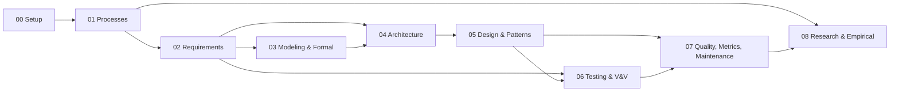
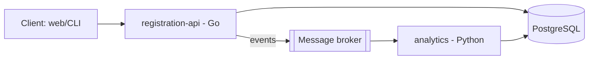

# PLAN — Advanced Software Engineering (Term 1)

> Phase 0 output. **Status: pilot scope approved 2026-11-23** (build `PLAN.md` + `00-setup` + `project/` skeleton + a full `01-processes`, then stop for review before modules 02–08).
> Progress (2026-11-23): ✅ `00-setup` · ✅ 01 (pilot, awaiting your review) · ☐ 02 · ☐ 03 · ☐ 04 · ☐ 05 · ☐ 06 · ☐ 07 · ☐ 08 · ☐ `STUDY-SCHEDULE` · ☐ `CHEATSHEET`.
> Pins for source-code case studies: Linux **v6.18.63** (`_shared/sources/linux/`), OpenBSD **`8cada8c`** (`_shared/sources/openbsd/`). Every quoted excerpt is copied from these checkouts (≤ 25 lines, cited with file, function and pin). Anything not checked is marked `UNVERIFIED`.
> Set the course in every `make` call: `COURSE=term-1/advanced-software-engineering`.

## 0. Assumptions

| Item | Assumption | Change it if… |
|---|---|---|
| Course material | The professor's lectures (Dr. Mohebbi) follow Schach, *Object-Oriented and Classical Software Engineering*, 8th ed. (McGraw-Hill, 2011). We use **Schach's vocabulary** (workflow, iteration vs incrementation, fault vs failure, postdelivery maintenance) and cite it by chapter and section, e.g. `Schach 8e, ch. 2 §2.9`. | the syllabus says otherwise; send it and I will remap modules |
| Alignment | **Hybrid**: Schach for terms and classical theory, then modern depth where the book is weak (DevOps/DORA, architecture evaluation, DDD, TLA+, mutation testing, MSR). Every difference appears in a box: *Schach says X; modern practice says Y*. | you want a strictly Schach-only syllabus |
| Grading | Research project (6) + final exam (14). Module 08 doubles as a guide for the research project; every quiz ends with 2–3 oral-exam questions. | — |
| Lab machine | Windows/Linux/macOS with **Go ≥ 1.22**, **Python ≥ 3.8**, Git, Docker (optional for compose labs). No VM needed. | Docker is not available (compose labs have a non-Docker fallback) |
| Languages | Go for services, Python for analytics and tooling (`ruff`-clean, as the repo's CI requires). Rust appears only where it shows a concept best (property-based testing in M06, ownership vs coupling in M05). | — |
| Pace | ~100 h total; one module ≈ 1.5–2 weeks at 60–90 min/day. | the exam date is closer |
| Book and lectures | Used as private reading. Nothing from `temp/` is committed or quoted at length; notes paraphrase and cite chapter/section only. | — |

## 1. Module order, dependencies, hours

| # | Module | Depends on | Lesson + notes | Labs | Total h |
|---|---|---|---|---|---|
| 00 | Setup | — | 1 | 3 | 4 |
| 01 | Software Processes & Lifecycle Models | 00 | 8 | 7 | 15 |
| 02 | Requirements Engineering | 01 | 8 | 7 | 15 |
| 03 | Modeling & Formal Methods | 02 | 8 | 8 | 16 |
| 04 | Software Architecture | 02, 03 | 8 | 8 | 16 |
| 05 | Design Principles & Patterns | 04 | 7 | 7 | 14 |
| 06 | Verification, Validation & Testing | 02, 05 | 8 | 8 | 16 |
| 07 | Quality, Metrics, Estimation & Maintenance | 05, 06 | 7 | 7 | 14 |
| 08 | Research Topics & Empirical SE | 01, 07 | 6 | 6 | 12 |
| | **Total** | | **60** | **61** | **~120** |

Dependency notes: M04's ATAM needs M02's quality attributes; M06's contract tests need M04's service boundaries; M07's Lehman study needs M08's mining method (the lab is placed in M08 and referenced from M07).

## 2. The running project: "Course Registration Platform"

One repository folder, `project/`, grows through the course. `m0` … `m8` name the state of the project after each module. The course repository has no such Git tags; each lab tells you to copy `project/` into a scratch directory, run `git init` there, and commit, so you work on your own history and your own `m0` … `m8` tags.

| Tag | Added by | State |
|---|---|---|
| `m0` | 00-setup | Go service skeleton (health, one `GET /courses`), tests, Python analytics stub, `docker-compose.yml`, `Makefile`, CI workflow |
| `m1` | 01 | CI gates, DORA metrics script, branching/release workflow, `CONTRIBUTING.md` (borrowed from Linux/OpenBSD practice) |
| `m2` | 02 | SRS (IEEE 29148 style), Gherkin acceptance tests, traceability matrix |
| `m3` | 03 | UML/C4 models, TLA+ model of enrollment concurrency, race found and fixed |
| `m4` | 04 | ADRs, modular monolith vs services comparison, ATAM, message broker, CQRS read model |
| `m5` | 05 | Refactoring of a smelly module with before/after metrics |
| `m6` | 06 | Mutation testing, property tests, Pact contracts, fuzzing |
| `m7` | 07 | Quality gates (linters, SonarQube), COCOMO II / FP estimate, SLO/SLI |
| `m8` | 08 | Repository-mining study report |

---

## 00 — Setup (4 h)

- **Guide (EN/FA):** what we build, tool list, how to cite Schach and the source repos, how the decks and labs are generated.
- **Labs (3):**
  1. Toolchain check (`go`, `python`, `ruff`, `git`, `docker`) with a script that prints versions and flags what is missing.
  2. Project skeleton (`project/`): build, test, lint, tag `m0`. Add a GitHub Actions workflow that runs the same commands.
  3. Diagram tooling: Mermaid and PlantUML render, C4 with Structurizr (Docker or local), where diagrams live.
- **Slides:** one deck for the guide and one deck per lab.

## 01 — Software Processes & Lifecycle Models (15 h)

- **Schach anchors:** ch. 1 (scope, crisis, economics, phases, terminology), ch. 2 (all life-cycle models), ch. 3 (Unified Process, CMM), ch. 4 (teams).
- **Notes (8):**
  1. the software crisis, economic aspects and why maintenance dominates
  2. classical phases vs workflows, and the cost of late faults
  3. iteration vs incrementation (the iterative-and-incremental model)
  4. plan-driven models: code-and-fix, waterfall, V-model, rapid prototyping
  5. risk-driven: the spiral model, and the Unified Process phases
  6. agile: XP, Scrum, Kanban, timeboxing, stand-ups; where agile fits and where it does not
  7. open-source and synchronize-and-stabilize models; choosing and mixing models
  8. process improvement and delivery: CMM/CMMI, DevOps, DORA metrics, teams (democratic, chief programmer, Brooks's law)
- **Case study (Linux vs OpenBSD):**
  - Process and review: `Documentation/process/submitting-patches.rst` (Linux v6.18.63) vs the OpenBSD commit and release practice (`share/man/man9/style.9` for KNF).
  - Coding standards: `Documentation/process/coding-style.rst` vs `style.9`.
  - Technical debt and evolution: `Documentation/process/deprecated.rst`.
  - Two classic sources checked and cited: Royce 1970 (waterfall), Boehm 1988 (spiral). Mark `UNVERIFIED` if they are not opened.
- **Labs (7):**
  1. Mine the Git history of `project/` (or any repo) for DORA metrics (deployment frequency, lead time) with a Python script.
  2. Build a CI pipeline with quality gates (lint, test, coverage threshold) on `project/`.
  3. Simulate the cost of fixing a fault by phase (Python) and reproduce the 0.85% vs 7.5% economics argument.
  4. `git bisect` and `git worktree` on a seeded regression.
  5. Kanban flow metrics (cycle time, WIP limits) from a small issue export.
  6. Timebox a sprint plan for the project backlog and compare with a waterfall plan (written exercise with a script).
  7. Write a `CONTRIBUTING.md` and review checklist modelled on Linux `submitting-patches.rst`.
- **Slides:** lesson deck (12–18 slides, 2 `CODE_WALKTHROUGH` slides with real excerpts) + one deck per lab. Layouts: `TWO_COLUMN_COMPARE`, `DATA_CHART`, `QUOTE / DEFINITION`.

## 02 — Requirements Engineering (15 h)

- **Schach anchors:** ch. 11, ch. 12 §12.1, ch. 13 §13.19 (use cases).
- **Notes (8):** elicitation and interviewing · FR vs NFR and ISO/IEC 25010 · use cases and user stories · acceptance criteria and Gherkin/BDD · SRS structure (IEEE 29148) · traceability · prioritization (MoSCoW, AHP) · rapid prototyping and requirements validation.
- **Case study:** a real SRS/RFC/KEP with a link and a short excerpt (candidate: a Kubernetes Enhancement Proposal) plus Linux `submitting-patches.rst` requirements for changes. `UNVERIFIED` until opened.
- **Labs (7):** SRS for the project · user stories → Gherkin → `godog`/`pytest-bdd` acceptance tests · traceability matrix generated from tags · AHP prioritization script · NFR scenarios (quality attributes) · prototype validation · requirements review checklist.

## 03 — Modeling & Formal Methods (16 h)

- **Schach anchors:** ch. 12 (FSM, Petri nets, Z), ch. 13 (class and dynamic models), ch. 17 (UML).
- **Notes (8):** UML class and sequence · state and activity · component and deployment · C4 model · OCL basics · finite-state machines and Petri nets (Schach) · Z notation overview · TLA+/Alloy and model checking.
- **Case study:** a published TLA+ spec or Alloy model with excerpt; Linux or OpenBSD state machines (e.g. TCP states) as real examples of FSMs.
- **Labs (8):** class model of the domain · sequence diagrams for enrollment · state machine for a course registration · C4 views in Structurizr · OCL invariants · TLA+ enrollment model (race found, then fixed) · Alloy model of prerequisites · map the fixed design back to Go code.

## 04 — Software Architecture (16 h)

- **Schach anchors:** ch. 8 §8.5 (architecture, frameworks, three-tier, MVC), ch. 14 (design).
- **Notes (8):** architectural styles · quality-attribute tactics · ADRs · ATAM · modular monolith vs microservices · hexagonal architecture · DDD (bounded contexts, aggregates) · CQRS and event sourcing.
- **Case study (Linux vs OpenBSD):** VFS ops tables (`include/linux/fs.h`, `struct file_operations`) vs OpenBSD vnode ops (`sys/sys/vnode.h`); `seccomp.c` vs `kern_pledge.c` as flexible vs opinionated API design.
- **Labs (8):** three ADRs · mini ATAM · ops-table plugin architecture in Go · bounded contexts · aggregate design · add a message broker · CQRS read model · architecture fitness test.

## 05 — Design Principles & Patterns (14 h)

- **Schach anchors:** ch. 7 (cohesion, coupling, information hiding, objects), ch. 8 §8.6–8.8 (patterns), ch. 14 (OO design).
- **Notes (7):** cohesion and coupling scales (Schach) vs modern metrics · information hiding and Parnas · SOLID · GoF patterns that matter in Go/Rust/Python · anti-patterns and code smells · Fowler refactoring catalog · technical debt.
- **Case study (Linux vs OpenBSD):** `container_of.h`, `kref.h` (ref counting, ops structs as Strategy) vs `queue.h`, `tree.h`.
- **Labs (7):** measure coupling · refactor a smelly module with named refactorings · patterns in Go · Rust ownership vs coupling · smell detection script · debt register · before/after metrics report.

## 06 — Verification, Validation & Testing (16 h)

- **Schach anchors:** ch. 6 (testing, inspections, proofs), ch. 15 §15.9–15.23 (black/glass box, regression, cleanroom).
- **Notes (8):** test levels · pyramid vs trophy (`OPINION / CONTESTED`) · coverage criteria (statement, branch, MC/DC) · mutation testing · property-based testing · contract testing · fuzzing and static analysis · formal verification vs testing.
- **Case study (Linux vs OpenBSD):** KUnit (`Documentation/dev-tools/kunit/`, `lib/kunit/`) vs `regress/sys/kern/`.
- **Labs (8):** coverage vs mutation score · property tests (`hypothesis`, `rapid`, `proptest`) · Pact contracts (break and watch CI fail) · `go test -fuzz` · static analysis gate · inspection exercise (Fagan) · regression suite design · KUnit-style harness.

## 07 — Quality, Metrics, Estimation & Maintenance (14 h)

- **Schach anchors:** ch. 5 (metrics), ch. 9 (planning and estimating, COCOMO), ch. 16 (maintenance).
- **Notes (7):** metrics (LOC, cyclomatic, Halstead, CK) · code-quality tools · effort estimation (COCOMO II, function points, story points) · maintenance types and economics (corrective, adaptive, perfective, preventive) · Lehman's laws and legacy modernization (strangler fig) · reliability (SLO/SLI, error budgets) · reverse engineering.
- **Case study:** `lizard`/`scc` on `kernel/sched/` vs `sys/kern/` (size, complexity, comment density).
- **Labs (7):** metrics report · SonarQube Community · COCOMO II and function-point estimates for the project · strangler fig on a legacy module · SLO and error-budget calculation · Lehman check (see M08 lab) · maintenance cost model.

## 08 — Research Topics & Empirical SE (12 h)

- **Schach anchors:** ch. 1 §1.1 (Standish data as an empirical anchor), ch. 18 (emerging technologies); the book has no research-methods chapter, so this module is built from papers.
- **Notes (6):** empirical methods (experiments, case studies, surveys, MSR) · threats to validity · AI-assisted development and its evaluation · MLOps and SE for ML · green software · reading and reviewing SE papers (ICSE, FSE, ASE, TSE, TOSEM).
- **Case study:** Parnas 1972, Brooks 1986 "No Silver Bullet", Lehman's laws, each opened and cited. Add one recent ICSE/FSE paper (`UNVERIFIED` until opened).
- **Labs (6):** PyDriller mining study of a real repo (Lehman's law) · statistical test on a small experiment · reproduce a metric from a paper · read-and-review a paper (template) · green-software measurement · outline a research-project proposal.

---

## Deliverable counts (target for the full course)

~60 notes × 2 languages, 61 labs, **9 lesson decks + 61 lab decks** (EN + FA each), 8 quizzes × 2, 8 `videos.md`, 8 case studies × 2, then `STUDY-SCHEDULE` and `CHEATSHEET` (EN + FA).

## Source-use rules

- Quotes: only from `_shared/sources/`, ≤ 25 lines, cited as `linux/<path> · <function> · v6.18.63` or `openbsd/<path> · <function> · 8cada8c`, with a line-by-line explanation in both languages.
- Books and papers are cited with chapter or section (and venue and year for papers). Nothing is invented; unverified items are marked `UNVERIFIED` with a way to check.
- Videos: only ones actually found and opened; give title, channel, URL, duration, level, why it fits.
- Schach: cited by `ch.` and `§` only; short paraphrase, no long quotes.

## Phase rules for this build

1. Pilot: this file, `00-setup`, `project/` (`m0`), then `01-processes`. Review point.
2. Modules 02–08 follow in order, each finished before the next, with a 5-line status after each.
3. Finally `STUDY-SCHEDULE` (4-week intensive and 10-week relaxed) and `CHEATSHEET`.
